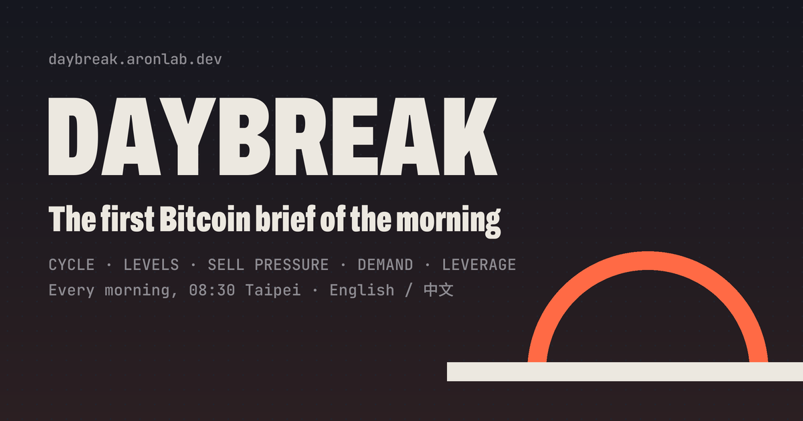

# 破曉 Daybreak

[](https://github.com/North7/daybreak/actions/workflows/daily.yml)
[](https://github.com/North7/daybreak/actions/workflows/check.yml)

**每天清晨的第一份比特幣簡報。** 今日要聞與解讀、市場數據、週期位置，以及「週期頂部分批出場」的框架與距離。

網站：<https://north7.github.io/daybreak/>（中文／英文；日刊／夜刊；可加到手機主畫面）



**[繁體中文](#繁體中文) · [English](#english)**

<a id="繁體中文"></a>


---

## 目錄

- [網站內容](#網站內容)
- [出場框架](#出場框架)
- [數字解讀](#數字解讀)
- [資料來源](#資料來源)
- [系統架構與每日流程](#系統架構與每日流程)
- [語言](#語言)
- [部署（一次性）](#部署一次性)
- [本機開發](#本機開發)
- [檔案結構](#檔案結構)
- [資料原則](#資料原則)
- [已知限制](#已知限制)
- [隱私](#隱私)
- [變更紀錄](#變更紀錄)

---

## 網站內容

10 個版面。桌面依序疊成一頁、捲動切換（鍵盤 1–9、0 跳版）；手機一次一版，左右滑動切換。5 個區塊以上的版面頂端有版內目錄；每格有圖的區塊可複製網址（`#版面/圖`，例如 `#onchain/sopr`）；長歷史的圖可切 1 年／3 年／全部；判讀文字裡的指標名可點、滑過有一句解釋。

| # | 版面 | 看什麼 |
|---|---|---|
| 01 | **頭版** | 號外大標題、巨型收盤價（滑過可回看近 20 天）、立場與市場階段、要盯的三個價位、數據帶、資料狀態、今天該做什麼／今天變了什麼、**我們的看法**（7 張圖的傾向與會改變看法的條件，從長線到短線排，點了跳到那張圖）、**訊號總表**（方向：市場階段、週線多空分數、今日發現；離頂部多近：MVRV ÷ 前高、頂部三指標、Tidemark、頂部雷達、冪律；離出場多遠：價格階梯、200 日均線避險；條一律是「離觸發多近」）、**今日發現**（上期發現的後續只列今天結案的，追蹤中的收合；附自動偵測的異動）、今日要聞（側欄只列標題）、離出場線的跑道圖、價格近一年、接下來的日期 |
| 02 | **消息** | 過去 24–36 小時的重要消息（依分類篩選），每則附「對 BTC 的意義」並對照本站數據；機構研報（Glassnode、K33 等）重點 |
| 03 | **週期** | 分三組：**現在的階段**（市場階段：熊市 → 轉換期 → 牛市，規則化判定與佐證燈號，6 張佐證圖預設收起；週線多空分數）；**離頂部多近**（MVRV ÷ 前一輪高點、頂部三指標、頂部雷達、兩者 6 項的近 3 年走勢）；**和歷史與模型比**（和前幾輪比：頂部之後、冪律合理價、Tidemark 綜合訊號、長期路徑四種走法） |
| 04 | **鏈上** | 分四組（版內目錄也分組）：**成本與位置**（籌碼分布 URPD、短期持有者獲利比例、短期持有者成本帶、依持有時間的持幣成本）；**獲利了結與認賠**（STH-SOPR 與短期持有者實現損益並排、每日淨實現損益、實現獲利 ÷ 虧損、賣方衰竭常數）；**長期持有者**（長短期持有者籌碼、價格 × 長期持有者動向、長期持有者虧損比例與已實現虧損）；**需求與資金**（表觀需求、循環資金流、鯨魚與大戶）；最後是鏈上指標表與走勢小圖。頂端另有短期持有者獲利比例、交易所供給、算力、難度的數字卡 |
| 05 | **價格** | 近 20 天 K 線、ATR、實際波動、Mayer 倍數、Pi Cycle、**短週期（目前這一段行情：起點、幅度、天數、與本輪中位數比較、本段結束線）**、關鍵價位、成本線與均線（短期持有者成本、真實市場均價、活躍投資人成本等，附我們的看法）、均線排列、長期走勢 |
| 06 | **資金** | 現貨 ETF 每日淨流量（並換算成 BTC 與新挖出量比較）、BTC 與那斯達克／美元相關、10 年期實質利率、三地溢價（美國現貨 Coinbase、亞洲 USDT 場外、永續對現貨）、穩定幣供給、恐懼貪婪指數、實現市值 30 日變化（附歷次歸零之後的價格表現） |
| 07 | **衍生品** | DVOL、IV − RV、永續資金費率（Deribit／OKX／Hyperliquid 以未平倉加權）、25Δ 風險逆轉（30 天固定期限）、選擇權未平倉與履約價分布、期貨基差曲線、**掛單簿**（13 個交易所 ±15% 全景柱狀圖、最大的牆、整數關卡）、CoinGlass 爆倉熱力圖連結 |
| 08 | **出場框架** | 現在離每條出場規則多遠、出場模擬器（拖動價格看框架會賣多少）、鏈上觸發、200 日均線避險、頂部三指標（只作讀值）與時間停損 |
| 09 | **往期** | 發現戰績（2026/10/23 起每則發現的最終結果：確認／推翻／到期／追蹤中；結案少於 30 則不算命中率）、往期列表（頭條、立場、當天收盤、到今天的漲跌） |
| 10 | **方法** | 這是什麼、原則、限制、資料來源與更新時間 |

## 出場框架

以「100% ＝ 本週期打算賣出的全部持倉」計，不涉及任何人的實際持倉。參數在 `data/model.json`，每月檢討時才改（長期路徑的權重與起點每月底自動更新）。

| 規則 | 內容 |
|---|---|
| 價格階梯 | 125K、135K、145K、155K、165K、180K、195K、215K，共 8 階，每階賣 12.5% |
| 鏈上觸發 | MVRV ÷ 前一輪高點連 5 日 ≥ 0.75 → 賣一階；連 5 日 ≥ 0.80 → 再賣一階；之後每次收盤創新高但 MVRV ≤ 一年最高的 0.9 倍 → 賣一階 |
| 頂部三指標（只作讀值） | MVRV Z／NUPL／Puell 四年百分位任兩項 ≥ 80 → 標為頂部區，不連動賣出（2026-11-05 起取消原本的加速規則，見變更紀錄） |
| 200 日均線避險 | 收盤連 5 日在 200 日均線之下 → 減 20%；連 5 日收回，或 MVRV Z 7 日均 < 0.5 → 補回 |
| 時間停損 | 2029/10–2030/03 剩餘部位每月等量賣完 |

**市場階段（P23）** 只是標籤，不連動出場規則：轉換期＝投降出現過且收盤在上升的 200 日均線之上；牛市＝收盤連 30 日在上升的 200 日均線之上（成立後單向鎖定）；退回熊市＝轉換期中連 5 日收在 200 日均線下，或牛市中連 30 日在下降的 200 日均線下。

## 數字解讀

頁面上每個數字都附一句「現在代表什麼」：由前端用當天的數值套固定門檻產生（門檻寫在句子裡），並標上 **偏多／偏空／留意／中性**。標籤只描述該數字對價格的一般含意，不是預測，也不連動出場規則。

**我們的看法**（2026-11-05 起，使用者要求「不只說數據，要基於數據給出具體觀點」）：成本線與均線、短期持有者成本帶、依持有時間的持幣成本、表觀需求、價格 × 長期持有者動向、長期持有者已實現虧損、和前幾輪比這 7 個面板，判讀最後一列是本站的觀點：傾向（例如區間整理、新買家套牢、換手中）、理由（會引用其他面板的數字互相印證），以及「會改變看法」的具體條件。由前端依當天資料自動判斷；不寫目標價、不標買賣區、不連動出場規則。

每版最上方的「今日判讀」與頭條、新聞、行動清單，則由 Claude 每日任務讀數據後撰寫（`data/notes.json`、英文版 `data/notes.en.json`），只解釋數字、不改數字。

**今日發現**（2026-10-23 起）：資料管線先依寫死的規則偵測異動（`pipeline/signals.py`：一年最極端的 2%、7 日急變、狀態翻轉、關鍵價位 ±3%、連續、跨指標組合），每日任務再從中寫 0–3 則發現：拆解是哪一邊在動、用不同來源交叉比對、列出其他解釋與資料限制、引用過去同樣情況（附樣本數）、寫下會確認或推翻的條件。下一期資料管線自動檢查這些條件，任務再寫後續（確認／推翻／到期／追蹤中）。

## 資料來源

全部是免費的公開 API，不需要任何金鑰。

| 來源 | 用在哪裡 | 更新 |
|---|---|---|
| Kraken | 日線價格、均線、ATR、波動、短週期 | 每日 |
| CoinMetrics Community | MVRV、實現價、**頂部三指標（MVRV Z／NUPL／Puell）**、交易所供給、實現市值、冪律、長期價格 | 每日（晚 1 天） |
| bitcoin-data.com | 籌碼流向（供給比、短期持有者獲利比例）、URPD、幣齡分布（長短期持有者籌碼推算用）、流動性供給、頂部雷達；長短期持有者成本、aSOPR、LTH SOPR、真實市場均價 2026-11-04 起改用 Bitview，只在 Bitview 失敗時即時要成本與均價 | 每日 10 次請求（免費層上限 15） |
| CheckOnChain 公開圖表 | STH-SOPR、短期持有者實現獲利／虧損、長短期持有者的實際籌碼分布、賣方衰竭常數、全網實現獲利 ÷ 虧損、HODL Waves（表觀需求）、長期持有者虧損比例（晚約 1 天；`pipeline/coc.py` 每天讀一次，失敗時用 `pipeline/coc_cache/`） | 不佔 bitcoin-data 額度 |
| Bitview（Bitcoin Research Kit 公開 API） | 長短期持有者成本、aSOPR、LTH SOPR、真實市場均價（佐證燈號、鏈上指標表）、短期持有者成本帶、3–6／6–12／12–18 個月持幣成本、依地址餘額分層的持幣量（鯨魚與大戶）、長短期持有者供給比、長期持有者已實現虧損、活躍投資人成本、1 週–1 個月持幣成本、長短期持有者籌碼「30 天前」的實際分布；真實市場均價每天和 CheckOnChain 對照 | 每日（晚 1 天，免費、不用金鑰） |
| Deribit | DVOL、期貨基差、選擇權、永續資金費率 | 每日 |
| OKX、Hyperliquid | 資金費率（與 Deribit 以未平倉加權）；OKX 永續逐小時未平倉量與 K 線（清算熱力圖，推算）；OKX 場外 USDT/CNY 報價與永續對現貨日線（三地溢價） | 每日 |
| 13 個交易所掛單簿 | Coinbase、Bitstamp、Gemini、Bitfinex、Kraken、Binance、OKX、Gate、MEXC、Deribit、Kraken Futures、OKX Swap、Hyperliquid | 每日快照 |
| The Block | 現貨 ETF 每日淨流量（與 Farside 同口徑） | 每日 |
| FRED | 10 年期殖利率與實質利率、美元指數、那斯達克 | 每日 |
| mempool.space | 算力、難度、礦工收入 | 每日 |
| BitInfoCharts | 2026-10-21 起被 Cloudflare 擋下；2026-11-04 起鯨魚分層改用 Bitview | — |
| DefiLlama | 穩定幣總供給 | 每日 |
| Coinbase、Binance | Coinbase 溢價（兩邊日線收盤價差） | 每日 |
| alternative.me | 恐懼貪婪指數 | 每日 |
| Tidemark（north7.github.io/tidemark） | 頂部／底部綜合訊號（第三方模型，只作讀值） | 每日 |

頁首「資料狀態」會列出每個來源的資料日期與落後天數；任何一個來源失敗只影響該項，頁面顯示「本日未取得」，不推估、不沿用舊數字。

## 系統架構與每日流程

```
cron-job.org ──(repository_dispatch)──▶ GitHub Actions
   22:40 UTC  prefetch.yml  → bd_rotation.py → pipeline/bd_cache/        （bitcoin-data 7 個）
   00:06 UTC  daily.yml     → collect.py → today.json
                            → etf.py     → data/etf.json
                            → build.py   → data/latest.json、data/history/、data/archive/
                            → 提交到 main ─▶ GitHub Pages
   14:00 UTC  etf.yml       → 補抓 ETF 流量

Claude 排程任務（00:30 UTC）→ brief.py 精簡摘要 + 查新聞與研報
                            → data/notes.json、data/notes.en.json → 提交到 main
瀏覽器 → index.html + assets/app.js 讀 latest.json 與 notes（英文版讀 notes.en.json）
```

| 時間（UTC） | 台北 | 誰 | 做什麼 | 耗 token |
|---|---|---|---|---|
| 22:40（前一天） | 06:40 | cron-job.org → Actions | 抓 8 個鏈上指標進 `pipeline/bd_cache/` | 0 |
| 00:06 | 08:06 | cron-job.org → Actions | 抓所有資料、算指標、更新 `data/latest.json`、封存前一期、提交 | 0 |
| 00:30 | 08:30 | Claude 排程任務 | 讀摘要、查證新聞與研報，寫頭條、各版判讀與英文版，提交 | 少量 |
| 14:00 | 22:00 | Actions | 補抓 ETF 流量（The Block 晚約一個交易日公布） | 0 |

GitHub 自己的定時排程在這個倉庫每天晚 5–7 小時，所以改由 cron-job.org 準時觸發（設定見 [docs/CRON_JOB.md](docs/CRON_JOB.md)）；原本的 `schedule` 與 Claude 推送 `.github/run-daily` 觸發都保留當備援，同一天重複觸發會自動略過。`notes.json` 的日期若和資料日不同，網站仍顯示上一期的判讀並標示，數字永遠是最新的。

## 語言

- 網站有中文（繁體）與英文兩種版本，右上角（手機）或側欄底部（桌面）切換。
- 使用者選過語言就一直沿用（存在瀏覽器 localStorage）。
- 沒選過時依訪客 IP 所在國家決定預設：**台灣、香港、澳門、中國大陸、新加坡用中文，其他地區用英文**。國家由瀏覽器向 api.country.is（備援 get.geojs.io）查詢，快取 7 天；查不到時看瀏覽器語言。
- 介面文字都經過 `_t()`，英文在 `assets/i18n-en.js`；數字解讀兩種語言都由前端產生；每日判讀需要 Claude 任務另寫 `data/notes.en.json`，缺檔時英文版退回中文並標示。

## 部署（一次性）

1. 建立公開倉庫並把內容推到 `main`。
2. **Settings → Pages**：Source 選「Deploy from a branch」，Branch `main`、資料夾 `/ (root)`。
3. **Settings → Actions → General → Workflow permissions** 選「Read and write permissions」。
4. Actions 頁面手動執行一次「Daily data」，確認 `data/latest.json` 有更新。
5. 依 [docs/CRON_JOB.md](docs/CRON_JOB.md) 建 GitHub token，在 cron-job.org 建兩個工作（daily-data 00:06、prefetch 22:40，UTC）。
6. 在 Claude Code 建每日排程任務（UTC 00:30），指示內容見 [docs/CLAUDE_DAILY.md](docs/CLAUDE_DAILY.md)。

## 本機開發

```bash
# 預覽網站（讀 repo 裡現有的 data/）
python3 -m http.server 8765        # 打開 http://localhost:8765/

# 改過 assets/ 之後：更新版本號，避免手機拿到新舊混搭的 CSS／JS
python3 pipeline/stamp_assets.py

# 改過 app.js 的文字之後：檢查每個 _t() 都有英文（缺的補進 assets/i18n-en.js）
python3 pipeline/check_i18n.py

# 渲染測試：中文／英文 × 桌面／手機，每一版都要能渲染、沒有 JS 錯誤、不能橫向捲動
npm i --no-save playwright@1.56.1 && npx playwright install chromium
node tests/smoke.js                # 需要上面的 http.server 在跑

# 完整跑一次資料管線（會打真實 API；bitcoin-data 每個 IP 每天 15 次，自己電腦跑也會用掉）
cd pipeline && python3 collect.py --up 87447 --down 82288 --prev-state state_min.json && cd ..
python3 pipeline/build.py pipeline/today.json
```

PR 會自動跑 **Site checks**（`.github/workflows/check.yml`）：語法、英文字典、版本號、用無頭瀏覽器渲染每一版。開發慣例：

- 網站純靜態、無外部套件、無建置步驟；圖表是手寫 SVG。
- 新文字用 `_t('中文')` 並把英文加進 `assets/i18n-en.js`；中英語序差很多的句子用 `_T('中文', 'English')`。
- 資料欄位一律「取不到就 null 並寫進 errors」，不推估。

## 檔案結構

```
index.html               網站入口（含開機腳本：先決定語言再啟動 app.js）
manifest.webmanifest     加到手機主畫面（圖示 assets/icon-*.png；中文預覽圖 assets/og.png）
assets/app.css           品牌與版面（號外風格；日刊／夜刊兩種主題）
assets/app.js            路由、圖表、數字解讀、互動（無外部套件）
assets/i18n-en.js        英文字典（中文原句 → 英文）
assets/logo.svg、favicon.svg
data/latest.json         每日資料（由 Actions 產生，不要手改）
data/notes.json          每日頭條、各版判讀、行動、變化、要聞與研報（Claude 每日任務寫入）
data/notes.en.json       notes.json 的英文版
data/etf.json            ETF 每日淨流量
data/model.json          固定模型參數：出場框架、長期路徑（出場框架每月檢討時才改；路徑的換錨、已實現點與權重由 path_review.py 每月底自動更新；含 *_en 英文規則文字）
pipeline/path_review.py  長期路徑每月重估：換錨、補已實現點、貝氏更新權重、61,000 失效、每日包絡檢查（build.py 每天呼叫）
data/history/index.json  每日快照索引
data/archive/            往期封存：每期 notes（含英文版）與 index.json（頭條、當天收盤、之後漲跌、要盯的價位有沒有被碰到）。
                         網站「往期」版讀 index.json 顯示發現戰績與往期列表（2026-11-04 起）
pipeline/collect.py      抓取所有 API 並計算指標 → pipeline/today.json
pipeline/build.py        today.json → data/latest.json；最後呼叫 archive.py 封存前一期
pipeline/archive.py      往期封存（一次性回填：python3 pipeline/archive.py --backfill-git）
pipeline/brief.py        印出精簡摘要給 Claude 讀（異動偵測放最前面）
pipeline/signals.py      異動偵測：極端值、急變、狀態翻轉、關鍵價位、連續、跨指標組合；檢查上期發現的追蹤條件（build.py 呼叫）
pipeline/etf.py          從 The Block 更新 ETF 每日淨流量
pipeline/bd_rotation.py  bitcoin-data 請求分配：每日即時 6 個 + 前一晚 7 個
pipeline/coc.py          STH-SOPR、短期持有者實現獲利／虧損、長短期持有者籌碼、賣方衰竭常數、全網實現獲利 ÷ 虧損、1 年以上未動供給、長期持有者虧損比例：讀 CheckOnChain 公開圖表（晚約 1 天）
pipeline/bitview.py      Bitview（BRK 公開 API）：短期持有者成本、真實市場均價、6–12／12–18 個月持幣成本，快取 coc_cache/bitview.json；真實市場均價每天和 CheckOnChain 對照
pipeline/hl_whales.py    Hyperliquid 帳戶淨值前 300 名的 BTC 部位彙總（不列個別帳戶，少於 2 個帳戶的組只給帳戶數）
pipeline/cohort_urpd.py  長短期持有者籌碼：URPD × 幣齡分布 × 每日價格區間推算 LTH／STH 籌碼（collect.py 每天呼叫）
pipeline/liq_heat.py     清算熱力圖：OKX 永續逐小時未平倉量＋假設槓桿推算各價位的待清算量（collect.py 每天呼叫）
pipeline/cohort_cache/   每天的完整 URPD（63 格）與幣齡分布存檔（bitcoin-data 免費層的 URPD 歷史只到約 2026-08-10）
pipeline/bd_cache/       前一晚抓的鏈上指標快取
pipeline/check_i18n.py   檢查 app.js 每個 _t() 都有英文
pipeline/stamp_assets.py 更新 index.html 的 ?v= 版本號
pipeline/share_card.py   每日分享圖 data/share.png、data/share-en.png（X 貼文附圖）
pipeline/picks.py        今日推薦圖表：挑 1–3 張圖、畫成 4:5 社群圖 data/picks/、檢查 data/picks.json 的解說（見 ops/picks/README.md）
post.html                轉址到 ops/post/（舊網址相容）
ops/                     運營：發文小幫手 post/、每日推薦圖表 picks/、短影片 video/（見 ops/README.md）
ops/post/index.html      X 發文小幫手（讀 data/x_post.json：手機用分享選單把圖文一起送進 X、存圖到相簿、開 X App 發文視窗、複製文字；下方「今日推薦圖表」讀 data/picks.json）
pipeline/og_card.py      連結預覽卡 assets/og-en.png（網址貼到 X 時自動顯示，預設英文；中文版 assets/og.png）
pipeline/x_len.py        檢查 data/x_post.json 中英貼文在 X 的 280 字內
pipeline/params.json     collect.py 需要的兩個參數（T+5 上下門檻）
pipeline/state_min.json  前一日的最小狀態（URPD 週變化、ATR 回測、市場階段）
tests/smoke.js           渲染測試
.github/workflows/daily.yml     每日資料（cron-job.org 00:06 UTC 觸發；schedule 與推送觸發為備援）
.github/workflows/prefetch.yml  鏈上快取（cron-job.org 22:40 UTC 觸發）
.github/workflows/etf.yml       每天 14:00 UTC 補抓 ETF
.github/workflows/check.yml     PR 檢查
.github/workflows/share.yml     日報推送後自動產生分享圖與今日推薦圖表
docs/CLAUDE_DAILY.md     Claude 每日任務的完整指示
docs/CRON_JOB.md         cron-job.org 準時觸發的設定步驟
```

## 資料原則

- **先給結論，再給證據。** 每版先寫「所以呢」，數字放在後面。
- **寧可「本日未取得」，也不推估或沿用舊數字。**
- **不同資料商的數字不相減**（例如 CoinMetrics 的 MVRV 與 bitcoin-data 的 MVRV Z 口徑不同）。
- **分數附樣本數**，樣本少於 30 不下結論；週期模型只有 3–4 輪歷史，所有「遞減」推論都假設趨勢延續。
- **只作讀值的東西不連動規則**：數字解讀、短週期、鯨魚、市場階段、Tidemark、新聞都不改變出場框架。

## 已知限制

- **bitcoin-data.com** 免費層每小時 10 次、每日 15 次；目前每天用 14 次（STH-SOPR 改由 CheckOnChain 提供；2026-10-27 加幣齡分布）。部分序列（例如持有者成本）本身就晚 5–6 天，頁首「資料狀態」會標出落後天數。
- **ETF**：Farside 用 Cloudflare 擋自動抓取，改用 The Block 的圖表 JSON（逐日與 Farside 比對一致）；The Block 只公布已完整的交易日，約晚一天。
- **掛單簿**是資料管線執行當下的快照；Binance 期貨與 Bybit 讀不到，永續部分偏低估；掛單隨時可撤。
- **鯨魚分層**：地址不等於實體，≥10K BTC 的地址多為交易所冷錢包與 ETF 託管，錢包整理會讓幣在分層之間移動；若 BitInfoCharts 改版或擋 GitHub Actions，該區塊顯示「本日未取得」。
- **Coinbase 溢價**以 Binance 的 USDT 報價比較，USDT 偏離 1 美元時會有誤差。
- **字型**：內文中文用系統字型，只有標題載入 Noto Sans TC 900；Google Fonts 在中國大陸讀不到時改用備用字型，版面已確認不會橫向溢出。
- **IP 判斷語言**會把訪客 IP 送到 api.country.is／get.geojs.io 查國家（只查國家代碼，結果存在訪客自己的瀏覽器）。

## X 推廣

- 每天 08:30 的日報任務寫完後，另寫 `data/x_post.json`（中英各一則 X 貼文草稿）並推播到手機，複製貼上即可發。
- 日報推送後，`share.yml` 自動產生號外風格的分享圖：`data/share.png`（中文）、`data/share-en.png`（英文）。
- 今日推薦圖表：日報任務另寫 `data/picks.json`（1–3 張圖，各一則中英文解說，只講市場資訊），`share.yml` 用 `pipeline/picks.py` 畫成 1080×1350 的圖放在 `data/picks/`，發文小幫手下方可分享、存圖、複製解說。
- 網站側欄與頁尾有追蹤 [@songpu717](https://x.com/songpu717) 的連結；貼文連結帶 `?utm_source=x`。
- 訪客統計用 GoatCounter（不用 cookie、不收個資），站點代號 `daybreak`，只在正式網址計數。
- 發文小幫手 [`ops/post/`](https://north7.github.io/daybreak/ops/post/)：一鍵複製中英文貼文、開好 X 發文視窗、存分享圖。
- 網址貼到 X 時自動顯示的連結預覽卡預設英文（`assets/og-en.png`，由 `pipeline/og_card.py` 產生）；中文版是 `assets/og.png`。

## 隱私

這是公開倉庫，所有歷史提交永久可查。網站只放市場資料與通用的出場框架（以「100% ＝ 本週期打算賣出的全部持倉」計），**不得出現任何人的實際持倉數量、買賣數量或資金金額**；Claude 每日任務在提交前會掃描 notes 確認。

## 變更紀錄

- **2026-09-22** 建立資料管線與網站。
- **2026-10-02** 籌碼流向圖表、掛單簿深度（3 家）、常駐圖表區。
- **2026-10-06** Tidemark 綜合訊號、冪律讀值、掛單簿全景擴大到 13 個交易所。
- **2026-10-08** bitcoin-data 請求分批輪替；ETF 改用 The Block。
- **2026-10-09** 市場階段（P23）規則修訂，佐證燈號。
- **2026-10-12**
  - 每個數字附解讀；英文版與依 IP 判斷語言；手機日夜／語言切換。
  - 新增：實現市值 30 日變化、鯨魚與大戶、短週期、穩定幣、Coinbase 溢價、算力帶、ETF 換算 BTC、多家資金費率、恐懼貪婪。
  - 頂部三指標改用 CoinMetrics（只晚 1 天）；25Δ 風險逆轉改 30 天固定期限；頁首資料狀態。
- **2026-10-15**
  - STH-SOPR 改用 CheckOnChain 公開圖表（晚約 1 天，原本 bitcoin-data 晚約 7 天），bitcoin-data 每日請求降為 13 次。
- **2026-11-06** 版面整理（使用者要求「整體整理一下目前的所有內容，優化版面，佈局」）
  - 「我們的看法」排到每張圖讀值的第一列，「會改變看法」的條件另起一行；細項讀值超過 3 列時，其餘收進「更多讀值」，圖往上移。
  - 頭版新增「我們的看法」總表：7 張圖的傾向與會改變看法的條件，從長線到短線排，點了跳到那張圖（看法本身仍在各面板，同一份判斷）。
  - 鏈上版分四組（成本與位置、獲利了結與認賠、長期持有者、需求與資金）＋指標總表，版內目錄也分組；「依持有時間的持幣成本」從週期版搬到鏈上版的成本組（舊連結 `#cycle/agecost` 會自動跟著圖走）；STH-SOPR 和短期持有者實現損益在桌面並排。
  - 週期版分三組：現在的階段 → 離頂部多近 → 和歷史與模型比。資金版的 ETF 流量和穩定幣在桌面並排。
  - 圖表面板裡，圖後面的表格（歷次紀錄、情境表）收成「展開表格」；長的說明只露前兩行，點「展開說明」看全文。頭版、消息、出場、往期、方法版不動。
  - 結果（桌面、中文）：週期版 7,927 → 6,730px；鏈上版多了搬來的持幣成本仍從 17,268 → 16,575px。只改版面與順序，資料、管線、看法判斷都沒動。
  - 版面順序改成頭版、消息、**週期**、**鏈上**、價格、資金、衍生品、出場框架、往期、方法（使用者要求週期放在鏈上前面；鍵盤 3＝週期、4＝鏈上）。
- **2026-11-04** 整體審查：頭版、訊號總表、結構與圖表
  - 頭版順序改成結論 → 今天該做什麼／今天變了什麼 → 訊號總表 → 今日發現 → 要聞（行動清單原本在第 4–5 屏）；桌面巨型收盤價限高約視窗 26%，立場與三個價位進到第一屏。
  - 上期發現的後續：今天結案的照列，追蹤中的收成一行（原本 12–13 則「追蹤中」把新發現壓到下面）。
  - 訊號總表取代「今日數據」6 張卡與重複同樣數字的解讀表：方向、離頂部多近、離出場多遠三組，條一律是「離觸發多近」，每列連到詳細圖。頭版要聞側欄只列標題。頭版高度手機 10,031 → 7,655px。
  - 每個指標只有一個家：獨立的 Coinbase 溢價圖併進三地溢價、鏈上版的短期持有者成本圖（與週期版佐證圖相同）拿掉、鏈上指標表不再重複 MVRV Z／NUPL／Puell；頂部三指標與頂部雷達的 6 張走勢小圖搬到週期版、和讀值放在一起；STH-SOPR 小圖拿掉（已有完整的圖）；舊連結會跟著圖走到新版面，異動偵測（`signals.py`）也改指到新的圖。
  - 結構：出場框架從第 8 版移到第 4 版；頂部雷達搬到週期版；市場階段 6 張佐證圖預設收起（週期版桌面 5,824 → 4,780px）；新增第 9 版「往期」（發現戰績與往期列表）。
  - 導覽：版內目錄、每格複製網址（`#版面/圖`）、判讀文字裡的指標名可點並附一句解釋。
  - 圖表：BTC 價格「另一刻度」的疊圖改成上下兩格；長歷史的圖加 1 年／3 年／全部。
  - `docs/CLAUDE_DAILY.md` 加「好讀」規則：第一句白話、一句最多 3 個數字、來源日期句尾集中寫一次、指標名照網站寫法。
- **2026-11-04** 圖表自我檢查與修正
  - 資料狀態：10/27 之後新增的 8 張圖（賣方衰竭、實現損益比、表觀需求、價格 × 長期持有者、週線多空分數、三地溢價、清算熱力圖）列進「資料狀態」；CheckOnChain 快取超過 4 天沒更新就不再沿用，該項顯示本日未取得。
  - 穩定性：一張圖出錯只影響自己（原本同一版後面的圖會全部空白）；週線多空分數少一項輸入時用其餘五項照算；槓桿百分位缺值時不再被當成「比平常便宜」。
  - 同一天各圖的價格統一用 Kraken 收盤（更早用 CoinMetrics），不再各用 CheckOnChain 自帶的價格；賣方衰竭的低點標在它自己那天，實現損益比的短紅段不會被抽樣漏掉。
  - 手機：頭版跑道圖依實際寬度排版（原本字只有約 4px）；各到期未平倉、基差曲線的日期標籤不再重疊；圖上的標註會自動避開彼此；鏈上指標小圖先顯示 3 張、其餘收在按鈕後；載入時只畫目前那一版。
  - 亞洲 USDT 溢價：歷史還短時 x 軸從第一點起算，不擠在 300 天軸的最右邊；清算熱力圖色階用整份快照算（切換 3／7 天顏色一致）、每根 K 線帶自己的時間。
  - `pipeline/check_i18n.py` 也檢查寫在 `_t`／`_T`／`h` 以外的中文字串。
- **2026-10-27**
  - 鏈上版：長短期持有者籌碼（Murphy〈跌破 $80K 的 BTC，潛在拋壓有多大？〉的拆法）。bitcoin-data 的 URPD 不分持有時間，用幣齡分布（hodl-waves-supply，每日 +1 次請求）與每日價格區間推算出 LTH／STH 各在哪個價位（`pipeline/cohort_urpd.py`）；附和約 30 天前比誰賣誰買、價格沒碰過的高位套牢盤變化（不靠模型）、跌到各價位的帳面虧損，以及推算的短期持有者成本 vs bitcoin-data 公布值（2026-09-30～10-20 差 −0.8%～−0.2%）。逐筆 UTXO、不是實體調整，只作讀值。
  - 每天的 URPD 完整存檔（`pipeline/cohort_cache/`）；異動偵測加「價格貼近短期持有者最厚的籌碼」。
  - 搬家日：單日大量從遠離現價的格子搬到現價（疑似同一實體內部轉帳，例如 10/22 約 21 萬顆從 62–66K、114K 進 80–82K），模型把這批幣放回原本的成本與幣齡，頁面與異動偵測（`jump:urpd-transfer`）標出；驗證仍用不修正的原樣（bitcoin-data 也是逐筆 UTXO）。感謝 Murphy 與 @market_beggar 指正。
  - 2026-10-28：長短期持有者籌碼「現在」那一張改用 CheckOnChain 依實際幣齡算的公開圖表（urpd_cohort，Bitcoin Research Kit；`pipeline/coc.py` 每天讀一次，不佔 bitcoin-data 額度），同樣套用搬家修正；「和約 30 天前比」仍是推算，並列出推算和實際的差距（10/28：STH 總量 −3.2%、約一成分到別的價位）。CheckOnChain 只有當下的快照，從 10/28 起每天存檔（`cohort_cache/coc_cohort.json`）。
  - 2026-10-29：鏈上版新增「價格 × 長期持有者動向」：價格線依長期持有者 30 日淨部位上色（紅＝淨減、灰＝持平、藍＝淨增），並寫出這段方向從哪天開始、同期價格怎麼走。畫法參考 Glassnode 的吸籌趨勢評分，但那個要實體歸類（付費）做不出來；bitcoin-data 同名的 accumulation-trend-score 和 LTH 30 日淨部位相關 0.97，等於同一個數字，所以直接用已抓的序列，不另打 API（`pipeline/stage_viz.py` 的 `lth_color_viz`）。
  - 2026-10-31：鏈上版「短期持有者獲利比例」上方加 BTC 週 K（Kraken 週線，週四起算；最後一根用已收盤日線重算），上下兩格共用時間軸與十字線，方便對照價格。
  - 2026-11-02：衍生品版新增「清算熱力圖（推算）」：用 OKX BTC 永續（USDT＋幣本位）逐小時未平倉量與 K 線，假設槓桿 5–100 倍，推算各價位等著被強制平倉的多單（收盤下方）與空單（上方），價格走過就清掉；可切 3 天／7 天，疊小時 K 線。每日快照（不是即時），只有 OKX（Binance、Bybit 從本站伺服器讀不到），不是 CoinGlass 的數字（`pipeline/liq_heat.py`；每天約 30 次 OKX 請求，不佔 bitcoin-data 額度）。
  - 2026-11-02：鏈上版新增「賣方衰竭常數」（Checkmate 設計：獲利供給比例 × 30 天價格波動；Murphy〈卖方衰竭指数〉用的是 Glassnode 版）。資料取自 CheckOnChain 公開圖表（2010 年起、晚約 1 天，每天 1 次，不佔 bitcoin-data 額度；`coc.get_sec`，快取 `coc_cache/seller-exhaustion.json`）。刻度和 Glassnode 版不同，0.01 的門檻不能套，極端區改用本身的歷史分布（低於 0.13，約 2011 年起最低 1.2% 的日子）；上格價格、下格指標，附歷次跌破後 90／180／365 天的漲跌與一年內最大回撤（`stage_viz.sec_viz`）。
  - 2026-11-02：鏈上版新增「實現獲利 ÷ 實現虧損（90 天平均）」（貝格先生分享的 Glassnode 圖的做法）：CheckOnChain 全網每日比值（2010 年起、晚約 1 天，每天 1 次；`coc.get_rpl`，快取 `coc_cache/realised-pl-ratio.json`）取 90 天平均，1 以上綠、以下紅；附歷次低於 1 的期間、大段紅色結束後一年內有沒有再跌破（2019/12–2020/1 例外）、最近 7 天每日比值與「維持這個水準何時跨過 1」的試算（`stage_viz.rpl_viz`）。
  - 2026-11-03：週期版新增「週線多空分數」（CryptoPainter 的 JT_Regime_Osc 不公開，改做本站自己的版本）：六項已有訊號（200 日均線位置、12 個月動能、MVRV 對一年均值、實現市值 30 日、交易所供給 90 日、實現獲利 ÷ 虧損 90 天）各除以歷史中位數取 tanh、平均 ×6，2013 年起每週一根；連續 4 週在另一邊才算翻轉，附歷次翻轉與 26／52 週後漲跌（`stage_viz.regime_viz`，不另打 API）。
  - 2026-11-03：資金版新增「三地溢價」（參考 CryptoPainter 的期現差價加權 USDT 溢價率，權重不公開，改成三條分開看）：美國 Coinbase 溢價、亞洲 OKX 場外 USDT/CNY 對匯率的溢價（只有快照，從 2026-11-02 起每日記在 `data/history/index.json`）、槓桿 OKX 永續對現貨（近 300 天日線），讀值寫出誰在推、誰在缺席（`collect.py` G9c；每天約 9 次 OKX 請求）。
  - 2026-11-03：長期路徑的每月重估自動化（10/31 那次因為沒有任何流程負責而漏掉，這次補做）：`pipeline/path_review.py` 每天由 build.py 呼叫，到了月底就依舊日報已裁示的規則換錨（起點＝月底收盤）、補已實現點、用月底收盤對各路徑當月值的對數常態似然（σ 12%）貝氏更新權重、收破 61,000 時「直接修復」歸零，計算過程寫進 `data/model.json` 的 `paths.reviews` 並在週期版公開；每天做包絡檢查，收盤連 10 天超出四條路徑上下 12% 才標記需要重估形狀（形狀仍須人工）。10 月結果：月底收 77,437，權重 30/20/25/25 → 27/21/26/26（直接修復／淺回檔／基準雙底／延後新低），包絡 0 天超出、形狀不變。
  - 2026-11-03：鏈上版新增「表觀需求（30 天合計）」（CryptoQuant 的 Apparent Demand）：30 天新挖出的幣 − 30 天內 1 年以上未動供給的變化，1 年以上供給取自 CheckOnChain HODL Waves（2010 年起、每天 1 次，`coc.get_hodl1y`，快取 `coc_cache/hodl-1y.json`）；2020 年起畫圖並疊 30 日平均。單日大量舊幣搬動（≥ 10 萬顆）標成疑似搬家，並提醒一年後的回音日（2025/11/22–23 搬了約 47 萬顆，回音在 2026/11/22 前後）（`stage_viz.ad_viz`）。
  - 2026-11-04：鏈上版新增「長期持有者虧損比例」（ForeDex 的 Supply In Loss % - LTH）：CheckOnChain 公開圖表（2009 年起、每天 1 次，`coc.get_lthloss`，快取 `coc_cache/lth-loss.json`），2013 年起畫圖，標出歷輪熊市底部的高點（2015/08 53.0%、2019/03 46.4%、2022/12 44.7%、2026/06 45.4%）與高點後的最高值；並用長期持有者籌碼分布每天重算「跌到多少會超過這輪高點」（11/03 約 61,000）（`stage_viz.lthloss_viz`）。
  - 2026-11-04：「短期持有者成本 vs 真實市場均價」由 bitcoin-data 改用 Bitview（使用者決定）：Bitview 和 CheckOnChain 的真實市場均價 2016 年以來差距中位數 0.01%，bitcoin-data 一直偏高約 1.5%、而且晚約 7 天；兩條線一律同一家，Bitview 失敗且快取超過 4 天時退回 bitcoin-data。下穿日因此由 4/26 改為 5/18。`pipeline/bitview.py`，每天拿 CheckOnChain 的真實市場均價驗算（差超過 0.5% 記進錯誤清單）。
  - 2026-11-04：鏈上版新增「短期持有者成本帶」（Murphy 的「短期持有者成本基礎模型」）：成本 ×（近 4 年「價格 ÷ 成本」的平均 ± 1、2 個標準差），−1 標準差和 Murphy 原文差不到 0.2%。週期版新增「6–12 與 12–18 個月持幣成本」（wander）：兩條年齡層成本線與歷次死叉／金叉，數字和原圖一致。兩張都用 Bitview。
  - 2026-11-04：RV30 加一年分位與一年低點（gaah_im 的低波動觀察）；冪律倍數旁加白話「低於趨勢 X%」。
  - 2026-11-04：每日淨實現損益「30 日累計」的觸發線改成「之前 4 年最大 30 日淨獲利 × −1/4」（使用者決定）：獲利與認賠的幅度每輪變小，舊的 4 年第 3 百分位拿上一輪熊市的大認賠當標準，本輪兩次低點都沒觸發。新規則 2015 起觸發 7 次（含 2026/02、2026/06），牛市回落最多只走到線的 46%；代價是 2022 年那次由 6/16 提早到 5/20。舊規則的結果另存 `trig_old`。
  - 2026-11-04：網站內容不再提個人名字（使用者要求）：圖表說明、讀值與 app.js 註解拿掉分析師／KOL 名字，每日任務加同一條規則。
  - 2026-11-04：長短期持有者成本、aSOPR、LTH SOPR 改用 Bitview（bitcoin-data 版晚 6–7 天；每日請求由 14 次降到 10 次）。長短期持有者籌碼的「STH 變化／LTH 變化」改成實際對實際（30 天前用 Bitview 依實際幣齡的分布，套用同樣的搬家修正）；誰賣了、誰轉成長期仍是推算。
  - 2026-11-04：鯨魚分層改用 Bitview 依地址餘額分層的持幣量（2011 起），整塊恢復顯示；週期版持幣成本加 3–6 個月切換（熊市後第一次上穿與之後的半年高點）；衍生品版清算熱力圖下加 Hyperliquid 大戶的 BTC 部位彙總（實際部位；原本想在熱力圖上畫個別清算價，但前 300 名只有約 35 個帳戶有 BTC 部位、收盤 ±30% 內只有 5 個清算價，畫出來等於公開個人部位，改成只給彙總）。
  - 2026-11-05：圖表風格新規則（使用者要求，見 `docs/chart-style.md`）：之後的圖要華麗、抓眼球、方便對外展示——大字讀數卡、漸層面積＋發光線、頂部／熊底底色、峰值膠囊、現在的脈動點。第一張是鏈上版「循環資金流：投機 vs 長線」（Look Into Bitcoin 的 Cycle Capital Flows，Bitview 實現市值加權的幣齡：1 個月內與 1–2 年各佔多少，數字和原圖一致）。
  - 2026-11-05：「籌碼結構與集中度」加第三格「短期壓力分數」（使用者要求放進來看相對關係；本站自製，不是 Glassnode 的 BRS）：四項短期持有者指標各和近 180 天比，0–100；時間範圍跟著上圖。讀值照實寫回測（到 100 買、回 0 賣：2013–17 年 12 次 11 次獲利、2018–22 年 7 次 1 次、2023 年起 9 次 7 次），只看相對高低。另修：手機上收在「展開其餘」後面的小圖（週期版頂部三指標的長期持有者 MVRV Z、獲利供給比例、長期持有者 30 日淨部位）畫的時候還藏著，描線動畫不會跑，線停在看不見、只剩最後一點；現在藏著時直接畫好線。
  - 2026-11-05：「籌碼集中度」升級成「籌碼結構與集中度」（使用者要求；BRS 是 Glassnode 付費專有指標、算法不公開，用公開資料做的替代分數在 2018–2022 年只有約五成勝率，使用者決定不放）：上格價格＋右緣當天的長短期持有者籌碼分布、現價 ±5% 區間；下格集中度改用 Bitview 全體 URPD（log1000 分格），歷史由 10/01 延長到 2018 年，標出歷史前 10% 高水位與每次首次衝上的位置；讀值加上「前 10% 之後 30 天最大波動中位數 23% vs 其他 16%，方向不定」。網站上的集中度統一改用這個算法（比舊算法高約 1–3 個百分點）。另修：歷史標記的空心圈不再跟著心跳。
  - 2026-11-05：Coinbase 溢價改版（使用者：「TradingView 已經收斂，你的圖還在底部」「運營用起來沒說服力」）：原本畫 7 日平均，會落後；改成每日值（柱）＋7 日平均（線），上格加價格，歷史由 300 天延長到約 4 年；標出歷次 7 日平均跌破 −0.15% 和 30 天後漲跌（4 年 4 次，前 3 次都上漲，樣本照實寫）；打開網頁時瀏覽器直接向 Coinbase、Binance 取最新一小時的即時值。
  - 2026-11-05：清算熱力圖加 Hyperliquid 大戶實際清算價：掃描由帳戶淨值前 300 名擴大到 2,000 名；清算價在 ±25% 內、同一個 1,000 美元價位至少 5 個帳戶且最大一個不超過一半時，在熱力圖右緣畫白條（目前大戶清算價分散、沒有聚集，所以沒有白條，讀值照實寫）。讀值列太長的數值改成可以換行，不再壓到標籤。
  - 2026-11-05：修正「長期持有者虧損比例」線尾：原本每 4 天取最高值，11/04 線尾畫在 33.6%、文字寫 31.5%；改成高點標在它自己那天、最新一天另外補上，線尾一定是當天值（和賣方衰竭、實現損益比同做法）。
  - 2026-11-05：全站圖表升級與配色重整（使用者要求「所有圖統一華麗一點」、問「為什麼都是紫色」）：圖表區頂端漸層色條、圖底光暈、彩色線發光、面積漸層加深、第一個讀值放大、最新一點心跳（只在畫面內、捲動時暫停，避免手機變卡）。主色改按指標類型分：成本與價位橙、獲利與情緒紫、籌碼與供給青綠、資金與衍生品金（見 `docs/chart-style.md`）。
  - 2026-11-05：週期階段配色（使用者要求「同樣牛熊，到了什麼階段，顏色要顯示」）：週線多空分數的柱子改五段——極熊（≤ −4）、熊、初牛（熊市滿 26 週後轉正的頭 26 週）、牛、過熱（≥ +4），面板上方直接寫目前階段；冪律圖新增「通道位置」看法（0%＝歷次底部連線、100%＝逐輪下降的頂部連線，對照冪律衰減通道震盪），線的顏色按五段變。
  - 2026-11-05：版面順序調整（使用者要求）：頭版、消息、**鏈上**、週期、價格、資金、衍生品、**出場框架**、往期、方法。鏈上是重點，移到第 3；出場框架離現在還遠，由第 4 移到第 8。
  - 2026-11-05：修正切到夜刊時語言切換的底色跑到 EN（實際語言沒變、「中文」字看不見）：夜刊的底色移動只套用在日刊／夜刊切換。
  - 2026-11-05：出場框架 v3：取消「加速」規則（頂部三指標任兩項 ≥ 85 連 5 日多賣兩階、≥ 90 十個交易日內賣完），頂部三指標改為只作讀值，任兩項 ≥ 80 仍標為頂部區。用網站自己的算法（CoinMetrics，2011 起）重播四輪：≥ 90 首次觸發都在週期中段（2017-04 在當輪頂部價的 7%、2020-12 的 39%、2024-03 的 58%），2021、2025 兩次真頂部當天都沒到 90；2021→2025 這輪平均賣價由頂部的 55% 變成 71%，四輪都不比原本差。也試過「已賣過一階才生效＋≥ 90 改成多賣兩階」：價格階梯從前高起算，2024-03 的中段高點正好剛突破前高，閘門只延後一天，平均只到 59%。限制：重播沒納入 200 日均線避險，舊週期的價格階梯以「前高 × 同樣倍數」換算，只有四輪樣本。
  - 2026-11-05：鏈上版「短期持有者成本帶」加 ±0.5 標準差兩條較細的點線（點子清單）：離現價最近的上下兩條，判讀的上緣／下緣也列出。11/04 的 +0.5 標準差 84,022、−0.5 標準差 74,071。
  - 2026-11-05：補三個指標（使用者轉來的補充指標整理，逐項對照過網站已有的內容）。①「表觀需求」加 1 年版（同樣算法的 365 天合計，圖上換算成每 30 天和 30 天版共用刻度）；「30 天負、1 年正」常被說成牛市中的回調，但 2016 年以來這種組合 767 天，之後 90 天上漲只占 52%（中位 +1.1%），比所有日子（60%、+9.9%）差，判讀照實寫。②「價格 × 長期持有者動向」加一行長短期持有者供給比（Bitview，現在 4.31，30 天前 4.70）。③「長期持有者虧損比例」下方加「長期持有者已實現虧損」（Bitview，7 日合計 ÷ 市值，2015 起）：驗證「價格新低但虧損變小＝賣壓衰竭」不成立，前三次熊市都是底部那次虧損最大（2015-01 0.86%、2018-12 2.86%、2022-11 1.30%），本輪 2026-06 的 0.29% 小得多。沒做的：CryptoQuant 的多頭分數（和週線多空分數重複）、長期持有者虧損比例套用 Glassnode 的門檻（口徑不同）。
  - 2026-11-05：X 帳號掃描（14 個鏈上帳號近一個月）後補三項。①「成本線與均線」加活躍投資人成本（Bitview，Cointime 的 Active Price）：11/04 是 85,113，今年 308 天只有 35 天收在它上方，和 Glassnode「85K 一直把價格擋回來」吻合（吻合是本站的觀察）。②「依持有時間的持幣成本」加「1 週–1 個月」切換（新買家成本，Bitview）：81,762，收盤低 1.6%、10/22 起在線下。③週期版新增「和前幾輪比：頂部之後」：頂部後第 394 天，前三輪 −72%、−81%、−75%，這輪 −35.5%；前三輪回到頂部價花 1,177、1,080、847 天。沒做：ETF 持倉成本——用 The Block 流量自算是 84.4K（平均成本），加上 GBTC 舊持幣是 74.1K，都對不上 Glassnode 的 81.5K（它用 ETF 錢包的鏈上實現價，要實體資料），照「對不上就不上線」。
  - 2026-11-05：7 個面板加「我們的看法」（使用者要求「不只說數據，要基於數據給出具體觀點」；參考 X 帳號掃描裡分析師的讀法：真實市場均價是多空分界、短期持有者成本在上漲中是支撐、回到新高前需要老手換手給新買家、認賠潮出現在局部低點）。11/04 的看法：區間整理（77.6K–85.1K，下方是短期持有者成本和真實市場均價，上方活躍投資人成本是今年的天花板）、新買家套牢、需求偏弱、換手中、這輪沒有大投降（偏向低點已過）、不是典型深熊。每一則都寫出會改變看法的條件。
  - 2026-11-04（參考 Glassnode 週報）：價格版新增「成本線與均線」（200／365 日、50 週均線＋短期持有者成本、真實市場均價、實現價、長期持有者成本）；資金版新增「BTC 對美股」（近 90 個美股交易日勝率與平均超額、近兩個月和 S&P 500、那斯達克、黃金〔PAXG〕的相對表現，FRED＋Kraken）；選擇權履約價分布可切換未平倉最大的兩個到期，加全部到期的買權／賣權合計；短期持有者獲利比例改用 Bitview、畫到 2019 並加 97.5% 賣出線與 50% 線；清算熱力圖用 OKX 4 小時線把歷史補到約 130 天（1 小時線只有 60 天），另列畫面外 ±25% 內最亮的一塊，並修正同一帶重複列出的問題。
  - 每日任務加「結構分析」：先問一個行情問題，拆參與者、比較前後、分清事實與推算、用行為確認、寫情境與推翻條件（`docs/CLAUDE_DAILY.md`）。
- **2026-10-23**
  - 鏈上版：短期持有者實現獲利與虧損（CheckOnChain，兩條分開、單位 BTC、已平滑），和 7 天前比，標出獲利 ÷ 虧損的變化主要是哪一邊帶動的。不佔 bitcoin-data 額度。
  - 頭版「今日發現」：異動偵測（`pipeline/signals.py`）＋每日任務寫的發現與後續；有異動的圖上方標出異動並畫日期線，「看圖 →」直接跳到那張圖；每則發現標偏多／偏空／中性，並算出整體多空。每日任務規則、`notes_lint.py` 與往期索引跟著加上 findings／followups。
- **2026-10-14**
  - 市場階段佐證燈號加第 6 盞：短期持有者成本 vs 真實市場均價（只作佐證）；六盞燈都有近 3 年走勢圖配 BTC 價格線，附「離翻轉多遠、以近 30 日速度大約何時交叉」的讀值（`pipeline/stage_viz.py`）。
  - X 推廣：英文連結預覽卡、發文小幫手 `post.html`。
  - 鏈上版：短期持有者認賠賣壓（STH-SOPR，自動標出「賣壓遞減／加重」）；鏈上指標表與頂部雷達的 11 項都有近 3 年走勢圖配價格線。
  - 全站每張圖下方加「讀圖」：「現在」一句依當日資料自動產生，「怎麼讀這張圖」說明圖上是什麼、怎麼看、要小心什麼。虛線一律代表推測或還沒發生的部分。
  - 掛單簿併入衍生品版；字型瘦身；往期自動封存；PR 自動檢查；cron-job.org 準時觸發；PWA 與分享預覽圖。

---

僅供研究與教育參考，不構成投資建議。加密資產波動極大，請依自身情況判斷並自負風險。

---

<a id="english"></a>

## English

**The first Bitcoin brief of the morning.** The day's news with analysis, market and on-chain data, where we are in the cycle, and how far price is from each rule of a staged exit plan for a cycle top.

Site: <https://north7.github.io/daybreak/> (Chinese / English; light / dark; installable on the phone home screen)

### What's on the site

Ten sections. On desktop they stack into one page and switch as you scroll (keys 1–9 and 0 jump between them); on phones one section shows at a time and you swipe left/right. Sections with five or more blocks have an in-page table of contents; every block with a chart has a copyable link (`#section/chart`, e.g. `#onchain/sopr`); long-history charts switch between 1Y / 3Y / All; indicator names in the written commentary link to their chart with a one-line definition on hover.

| # | Section | What you see |
|---|---|---|
| 01 | **Front page** | Headline, the giant closing price (hover to step back through 20 days), stance and market stage, three levels to watch, data tape, data-status bar, what to do / what changed, **our read** (the lean and what would change it for seven charts, long-term to short-term, each linking to its chart), the **signal board** (direction: market stage, weekly regime score, today's findings; how close to a top: MVRV ÷ prior peak, top-3 indicators, Tidemark, top radar, power law; how far from the exit rules: price ladder, 200-day MA hedge; every bar reads as “how close to its trigger”), **today's findings** (follow-ups show only those resolved today, the rest folded away; plus the auto-detected signals), today's news (headlines only in the side column), the runway to each exit line, the 12-month price chart, upcoming dates |
| 02 | **News** | Key stories from the last 24–36 hours (filter by category), each with what it means for BTC checked against our data; institutional research (Glassnode, K33, …) |
| 03 | **Cycle** | Three groups: **where we are** (market stage: bear → transition → bull, rule-based with supporting signals, the six evidence charts start folded; weekly regime score); **how close to a top** (MVRV ÷ prior-cycle peak, top-3 indicators, top radar, 3-year trends of all six); **against history and models** (versus past cycles after the top, power-law fair value, Tidemark composite, four long-term paths) |
| 04 | **On-chain** | Four groups (the page index is grouped too): **cost and position** (URPD, short-term holders in profit, short-term holder cost bands, holder cost by coin age); **profit-taking and loss-selling** (STH-SOPR and short-term holder realized P/L side by side, daily net realized P/L, realized profit ÷ loss, seller exhaustion constant); **long-term holders** (long- vs short-term holder supply, price × long-term holder flow, LTH supply in loss and LTH realized loss); **demand and money** (apparent demand, capital flow, whales); then the on-chain table and small trend charts. Number cards on top: short-term holders in profit, exchange supply, hashrate, difficulty |
| 05 | **Price** | 20 daily candles, ATR, realized volatility, Mayer multiple, Pi Cycle, **short cycle (the current price leg: start, size, length vs. this cycle's median, the close that would end it)**, key levels, cost bases and moving averages (short-term holder cost, true market mean, active investor price and more, with our read), moving-average alignment, long-term chart |
| 06 | **Flows** | Spot ETF daily net flows (also in BTC vs. newly mined supply), BTC correlation with Nasdaq / USD, 10-yr real yield, three premiums (US spot via Coinbase, Asian OTC USDT, perp vs spot), stablecoin supply, Fear & Greed, realized-cap 30-day change (with what price did after every past zero) |
| 07 | **Derivatives** | DVOL, IV − RV, perp funding (Deribit / OKX / Hyperliquid, open-interest weighted), 25Δ risk reversal (30-day constant maturity), options open interest and strikes, futures basis curve, **order book** (13 exchanges, ±15% full-view bar chart, biggest walls, round numbers), link to the CoinGlass liquidation heatmap |
| 08 | **Exit plan** | How far price is from each exit rule, an exit simulator (drag a price and see what the plan would have sold), on-chain triggers, 200-day MA hedge, top-3 indicators (reading only) and time stop |
| 09 | **Archive** | Findings track record (every finding since 2026/10/23 and how it ended: confirmed / refuted / expired / still tracked; no hit rate until 30 are resolved) and past editions (headline, stance, that day's close, change since) |
| 10 | **Method** | What this is, principles, limits, data sources and update times |

### The exit plan

Measured as "100% = everything you plan to sell this cycle"; nobody's actual holdings are involved. Parameters live in `data/model.json` and only change at the monthly review (the long-term paths' weights and start update automatically each month end).

| Rule | What it does |
|---|---|
| Price ladder | 125K, 135K, 145K, 155K, 165K, 180K, 195K, 215K — 8 steps, 12.5% each |
| On-chain triggers | MVRV ÷ prior-cycle peak ≥ 0.75 for 5 days → sell one step; ≥ 0.80 for 5 days → one more; after both, each new closing high with MVRV ≤ 0.9× its 1-year high → one more |
| Top-3 indicators (reading only) | MVRV Z / NUPL / Puell 4-year percentiles: any two ≥ 80 → marked as the top zone, no selling attached (the old acceleration rule was dropped on 2026-11-05; see the changelog) |
| 200-day MA hedge | Close below the 200-day MA for 5 days → cut 20%; buy back after 5 closes above it, or when the MVRV Z 7-day average < 0.5 |
| Time stop | 2029/10–2030/03: sell what is left in equal monthly amounts |

**Market stage (P23)** is a label only and does not drive the exit rules: transition = capitulation has occurred and the close is above a rising 200-day MA; bull = 30 straight closes above a rising 200-day MA (then locked one way); back to bear = 5 closes below the 200-day MA during a transition, or 30 closes below a falling 200-day MA in a bull market.

### Readings under every number

Every number on the page carries a one-line "what this means now", generated in the browser from the day's value and fixed thresholds (the thresholds are written in the sentence) and tagged **Bullish / Bearish / Caution / Neutral**. Tags describe what the number usually means for price; they are not forecasts and do not drive the exit rules.

**Our read** (since 2026-11-05, at the user's request to give concrete views, not just data): seven panels (cost bases and moving averages, short-term holder cost bands, holder cost by coin age, apparent demand, price × long-term holder flow, long-term holder realized loss, versus past cycles) end with the site's own view: a lean (for example range, new buyers under water, handover under way), the reasons (often cross-checked against other panels), and the specific condition that would change it. It is generated in the browser from the day's data; no price targets, no buy/sell zones, and no link to the exit rules.

The "Today's read" at the top of each section, the headline, the news and the action list are written by a scheduled Claude task after it reads the data (`data/notes.json`, English in `data/notes.en.json`). The commentary explains numbers; it never changes them.

**Today's findings** (from 2026-10-23): the pipeline first detects signals with fixed rules (`pipeline/signals.py`: the most extreme 2% of the past year, sharp 7-day moves, state flips, key levels within ±3%, streaks, cross-indicator combos); the daily task then writes 0–3 findings from them: which side is moving, cross-checks against other sources, alternative explanations and data limits, past occurrences (with sample size), and conditions that would confirm or refute it. The next build checks those conditions automatically and the task writes the follow-up (confirmed / refuted / expired / watching).

### Data sources

All free public APIs; no keys required.

| Source | Used for | Update |
|---|---|---|
| Kraken | Daily price, moving averages, ATR, volatility, short cycle | Daily |
| CoinMetrics Community | MVRV, realized price, **top-3 indicators (MVRV Z / NUPL / Puell)**, exchange supply, realized cap, power law, long-term price | Daily (1-day lag) |
| bitcoin-data.com | Supply flows (STH/LTH ratio, STH in profit), URPD, coin-age bands (for the LTH / STH split), liquid supply, top radar; holder costs, aSOPR, LTH SOPR and true market mean moved to Bitview on 2026-11-04 | 10 requests a day (free tier allows 15) |
| CheckOnChain public charts | STH-SOPR, short-term holder realized profit/loss, actual supply distribution by long- and short-term holders, seller exhaustion constant, network realized profit ÷ loss, HODL waves (apparent demand), LTH supply in loss (about 1 day late; `pipeline/coc.py` reads it once a day and falls back to `pipeline/coc_cache/`) | Doesn't use bitcoin-data quota |
| Deribit | DVOL, futures basis, options, perp funding | Daily |
| OKX, Hyperliquid | Funding (OI-weighted with Deribit); OKX perpetuals' hourly open interest and candles (liquidation heatmap, estimate); OKX OTC USDT/CNY quotes and perp-vs-spot daily bars (three premiums) | Daily |
| 13 exchange order books | Coinbase, Bitstamp, Gemini, Bitfinex, Kraken, Binance, OKX, Gate, MEXC, Deribit, Kraken Futures, OKX Swap, Hyperliquid | Daily snapshot |
| The Block | Spot ETF daily net flows (same basis as Farside) | Daily |
| FRED | 10-yr nominal and real yields, dollar index, Nasdaq | Daily |
| mempool.space | Hashrate, difficulty, miner revenue | Daily |
| BitInfoCharts | Blocked by Cloudflare since 2026-10-21; whale tiers come from Bitview since 2026-11-04 | — |
| DefiLlama | Total stablecoin supply | Daily |
| Coinbase, Binance | Coinbase premium (difference between their daily closes) | Daily |
| alternative.me | Fear & Greed Index | Daily |
| Tidemark (north7.github.io/tidemark) | Top/bottom composite signals (third-party model, reading only) | Daily |

The "Data status" bar at the top lists every source's data date and lag. If a source fails, only that item shows "not available today" — nothing is estimated or carried over.

### Architecture and daily schedule

```
cron-job.org ──(repository_dispatch)──▶ GitHub Actions
   22:40 UTC  prefetch.yml  → bd_rotation.py → pipeline/bd_cache/        (7 bitcoin-data series)
   00:06 UTC  daily.yml     → collect.py → today.json
                            → etf.py     → data/etf.json
                            → build.py   → data/latest.json, data/history/, data/archive/
                            → commit to main ─▶ GitHub Pages
   14:00 UTC  etf.yml       → ETF flow catch-up

Scheduled Claude task (00:30 UTC) → brief.py summary + news and research checks
                                  → data/notes.json, data/notes.en.json → commit to main
Browser → index.html + assets/app.js read latest.json and notes (English reads notes.en.json)
```

| UTC | Taipei | Who | What | Tokens |
|---|---|---|---|---|
| 22:40 (day before) | 06:40 | cron-job.org → Actions | Fetch 8 on-chain series into `pipeline/bd_cache/` | 0 |
| 00:06 | 08:06 | cron-job.org → Actions | Fetch everything, compute, update `data/latest.json`, archive the previous edition, commit | 0 |
| 00:30 | 08:30 | Claude task | Read the summary, verify news and research, write the headline, section reads and the English edition, commit | Few |
| 14:00 | 22:00 | Actions | ETF flow catch-up (The Block publishes about one trading day late) | 0 |

GitHub's own cron runs 5–7 hours late on this repository, so cron-job.org triggers the workflows on time (setup in [docs/CRON_JOB.md](docs/CRON_JOB.md)). The original `schedule` and the Claude task's push to `.github/run-daily` remain as fallbacks; duplicate triggers on the same day exit early. If `notes.json` is older than the data, the site shows the previous edition's commentary with a label, while every number is current.

### Languages

- Traditional Chinese and English; switch at the top right (phone) or the bottom of the sidebar (desktop).
- A visitor's choice is remembered (browser localStorage).
- Without a choice, the visitor's country decides: **Taiwan, Hong Kong, Macau, mainland China and Singapore get Chinese; everyone else gets English.** The browser asks api.country.is (fallback get.geojs.io) for the country code and caches it for 7 days; if that fails, the browser language decides.
- UI text goes through `_t()` with English in `assets/i18n-en.js`; readings are generated in both languages; the daily commentary needs the Claude task to write `data/notes.en.json` (if it is missing, English pages fall back to Chinese with a notice).

### Deploy (one time)

1. Create a public repository and push to `main`.
2. **Settings → Pages**: "Deploy from a branch", branch `main`, folder `/ (root)`.
3. **Settings → Actions → General → Workflow permissions**: "Read and write permissions".
4. Run "Daily data" once from the Actions tab and check that `data/latest.json` updates.
5. Follow [docs/CRON_JOB.md](docs/CRON_JOB.md) (in Chinese): create a GitHub token and two cron-job.org jobs (daily-data 00:06, prefetch 22:40, UTC).
6. Create the scheduled Claude Code task (00:30 UTC) with the instructions in [docs/CLAUDE_DAILY.md](docs/CLAUDE_DAILY.md).

### Local development

```bash
# Preview the site (uses the data/ already in the repo)
python3 -m http.server 8765        # open http://localhost:8765/

# After changing assets/: bump version stamps so phones never mix old and new CSS/JS
python3 pipeline/stamp_assets.py

# After changing text in app.js: every _t() string needs English (add missing ones to assets/i18n-en.js)
python3 pipeline/check_i18n.py

# Render test: zh/en × desktop/phone; every section must render with no JS errors and no horizontal scroll
npm i --no-save playwright@1.56.1 && npx playwright install chromium
node tests/smoke.js                # needs the http.server above

# Run the whole pipeline (real APIs; bitcoin-data allows 15 requests per IP per day, including yours)
cd pipeline && python3 collect.py --up 87447 --down 82288 --prev-state state_min.json && cd ..
python3 pipeline/build.py pipeline/today.json
```

Pull requests run **Site checks** (`.github/workflows/check.yml`): syntax, English dictionary coverage, version stamps, and a headless render of every section. Conventions:

- Static site, no external libraries, no build step; charts are hand-written SVG.
- New text uses `_t('中文')` with its English added to `assets/i18n-en.js`; sentences whose word order differs a lot use `_T('中文', 'English')`.
- A data field that cannot be fetched is null and listed in `errors` — never estimated.

### Data principles

- **Conclusion first, evidence second.**
- **"Not available today" beats an estimate or yesterday's number.**
- **Numbers from different vendors are never subtracted** (e.g. CoinMetrics MVRV vs. bitcoin-data MVRV Z).
- **Scores come with sample sizes**; nothing is concluded from fewer than 30 samples. The cycle model has only 3–4 cycles of history, and every "diminishing returns" inference assumes the trend continues.
- **Readings never drive rules**: number readings, the short cycle, whales, market stage, Tidemark and news do not change the exit plan.

### Known limits

- **bitcoin-data.com** free tier: 10 requests per hour, 15 per day; we use 14 (STH-SOPR now comes from CheckOnChain; coin-age bands added 2026-10-27). Some series (e.g. holder cost basis) are themselves 5–6 days behind; the data-status bar shows the lag.
- **ETF flows**: Farside blocks automated access behind Cloudflare, so we use The Block's chart JSON (matches Farside day by day); The Block only publishes complete trading days, about one day late.
- **Order book** is a snapshot at pipeline run time; Binance futures and Bybit are not readable, so perpetual depth is understated; orders can be pulled at any time.
- **Whale tiers**: one address is not one entity; ≥10K BTC addresses are mostly exchange cold wallets and ETF custodians, and wallet reshuffles move coins between tiers. If BitInfoCharts changes its page or blocks GitHub Actions, the panel shows "not available today".
- **Coinbase premium** is measured against Binance's USDT price; USDT deviating from $1 adds noise.
- **Fonts**: body Chinese uses system fonts; only headings load Noto Sans TC 900. Where Google Fonts is unreachable (e.g. mainland China), fallback fonts are used and the layout has been checked for horizontal overflow.
- **IP-based language** sends the visitor's IP to api.country.is / get.geojs.io to get a country code (stored only in the visitor's own browser).

### Promotion on X

- After the 08:30 daily task finishes the notes, it writes `data/x_post.json` (one X post draft in Chinese, one in English) and sends it to the phone as a push notification, ready to copy and post.
- Once the notes are pushed, `share.yml` draws Extra-style share cards: `data/share.png` (Chinese) and `data/share-en.png` (English).
- Today's picks: the daily task also writes `data/picks.json` (1–3 charts, each with a Chinese and an English caption, market information only); `share.yml` runs `pipeline/picks.py` to draw them as 1080×1350 images in `data/picks/`, shown at the bottom of the posting helper with share, save and copy-caption buttons.
- The sidebar and footer link to [@songpu717](https://x.com/songpu717); post links carry `?utm_source=x`.
- Visitor stats use GoatCounter (no cookies, no personal data), site code `daybreak`, counted on the live URL only.
- [`ops/post/`](https://north7.github.io/daybreak/ops/post/) is the posting helper: copy either draft with one tap, open X's composer pre-filled, save the share card.
- The link preview X shows for the site URL defaults to English (`assets/og-en.png`, drawn by `pipeline/og_card.py`); the Chinese card is `assets/og.png`.

### Privacy

This repository is public and its history is permanent. The site holds only market data and a generic exit framework ("100% = everything you plan to sell this cycle"); **it must never contain anyone's actual holdings, trade sizes or amounts of money.** The Claude task scans the notes for this before committing.

### Changelog

- **2026-09-22** Data pipeline and site created.
- **2026-10-02** Supply-flow charts, order-book depth (3 venues), always-on charts.
- **2026-10-06** Tidemark composite signals, power-law readings, order-book full view expanded to 13 exchanges.
- **2026-10-08** bitcoin-data requests split and rotated; ETF flows moved to The Block.
- **2026-10-09** Market stage (P23) rules revised; supporting signals.
- **2026-10-12**
  - A reading under every number; English edition with IP-based default language; theme/language switch on phones.
  - New: realized-cap 30-day change, whales and big holders, short cycle, stablecoins, Coinbase premium, Hash Ribbons, ETF flows in BTC, multi-venue funding, Fear & Greed.
  - Top-3 indicators from CoinMetrics (1-day lag); 25Δ risk reversal at 30-day constant maturity; data-status bar.
- **2026-10-15**
  - STH-SOPR now comes from CheckOnChain's public chart (about 1 day late, vs ~7 days at bitcoin-data); bitcoin-data use drops to 13 requests a day.
- **2026-11-06** Layout clean-up
  - “Our read” now leads each chart's readings, with what would change it on its own line; when a panel has more than three detail readings, the rest fold under “More readings” so the chart moves up.
  - The front page gains an “Our read” table: the lean and what would change it for seven charts, long-term to short-term, each linking to its chart.
  - On-chain is split into four groups (cost and position, profit-taking and loss-selling, long-term holders, demand and money) plus the metrics table, with a grouped page index; “Holder cost by coin age” moves here from Cycle (old `#cycle/agecost` links follow the chart); STH-SOPR and short-term holder realized P/L sit side by side on desktop.
  - Cycle is split into three groups: where we are → how close to a top → against history and models. ETF flows and stablecoins sit side by side on Flows.
  - Page order is now Front page, News, **Cycle**, **On-chain**, Price, Flows, Derivatives, Exit plan, Archive, Method (keys 3 = Cycle, 4 = On-chain).
  - In chart panels, tables after the chart (past episodes, scenarios) fold under “Show table”, and long notes show two lines until “More” is clicked. Layout and order only; data, pipeline and views are unchanged.
- **2026-11-05** Exit plan v3; cost-band lines; indicator additions
  - Seven panels gain “Our read”, the site's own view built from the data (lean, reasons, and what would change it), drawing on how analysts read these measures (true market mean as the bull/bear line, short-term holder cost as support in uptrends, a veteran-to-new-buyer handover before new highs, loss-selling bursts at local lows). On 11/04: range between 77.6K and 85.1K, new buyers under water, weak demand, handover under way, no big capitulation this cycle (leaning to the low being in), not a classic deep bear.
  - After scanning 14 on-chain X accounts: (1) “Cost bases and moving averages” gains the active investor price (Bitview, Cointime Active Price): 85,113 on 11/04, with only 35 of 308 days this year closing above it, in line with Glassnode's “85K keeps turning BTC back” (the match is our own observation). (2) “Holder cost by coin age” gains a 1-week–1-month view (new buyers' cost, Bitview): 81,762, with the close 1.6% below since 10/22. (3) Cycle gains “Versus past cycles: after the top”: on day 394 past cycles were −72%, −81% and −75%, this one −35.5%; past cycles took 1,177, 1,080 and 847 days to close above the top again. Not added: ETF cost basis, since our own figure from The Block flows (84.4K average cost; 74.1K with GBTC's legacy coins) does not match Glassnode's 81.5K, which uses on-chain ETF wallets (entity data).
  - Three additions after checking a user-supplied indicator list against what the site already has: (1) apparent demand gains a 1-year version (the same sum over 365 days, drawn per 30 days on the 30-day scale); “30d negative, 1y positive” is often read as a bull-market pullback, but since 2016 that combination (767 days) saw price higher 90 days later only 52% of the time (median +1.1%) versus 60% (+9.9%) for all days, and the reading says so. (2) “Price × long-term holder flow” gains a line for the LTH ÷ STH supply ratio (Bitview; 4.31 now, 4.70 a month ago). (3) Below “Long-term holder supply in loss”, a new “Long-term holder realized loss” (Bitview, 7-day sum ÷ market cap, since 2015): the idea that a new low with a smaller loss means seller exhaustion does not hold, since each of the past three bear markets saw its largest loss at the bottom (2015-01 0.86%, 2018-12 2.86%, 2022-11 1.30%); this cycle's 2026-06 peak was 0.29%. Not added: CryptoQuant's Bull Score (duplicates the weekly bull/bear score) and Glassnode thresholds for LTH supply in loss (different method).
  - The acceleration rule (top-3 indicators, any two ≥ 85 for 5 days → sell two extra steps; ≥ 90 → sell everything within 10 trading days) is dropped. The top-3 indicators are now a reading only; any two ≥ 80 still marks the top zone. A replay of four cycles since 2011 with the site's own method (CoinMetrics): ≥ 90 first fired mid-cycle every time (2017-04 at 7% of that cycle's top, 2020-12 at 39%, 2024-03 at 58%) and was not reached on the day of the 2021 or 2025 top; in 2021→2025 the average sale price goes from 55% to 71% of the top, and no cycle comes out worse. Gating the rule on "at least one step sold" with ≥ 90 selling only two steps reached 59%: the ladder starts at the prior high, which the 2024-03 mid-cycle peak had just broken, so the gate opened a day later. Limits: the replay leaves out the 200-day MA hedge, scales older ladders by the prior top, and has only four cycles.
  - On-chain “Short-term holder cost bands” gains thinner dotted lines at ±0.5σ, the nearest bands above and below price; the upper/lower readings list them too. On 11/04: +0.5σ 84,022, −0.5σ 74,071.
- **2026-11-04** Product review: front page, signal board, structure and charts
  - Front-page order: conclusion → what to do / what changed → signal board → findings → news (the action list used to sit 4–5 screens down); on desktop the giant closing price is capped at about 26% of the window so the stance and three levels fit on the first screen.
  - Follow-ups: those resolved today are listed; the ones still being tracked fold into one line (12–13 “watching” items used to push the new findings down).
  - A signal board replaces the six “Today's numbers” cards and the table that repeated them: direction, how close to a top, how far from the exit rules; every bar reads as “how close to its trigger”, and each row links to its chart. News in the front-page side column is headlines only. Front page on mobile: 10,031 → 7,655px.
  - One home per indicator: the separate Coinbase premium chart folds into the three premiums, the on-chain STH cost chart (same lines as the cycle evidence chart) is gone, the on-chain table no longer repeats MVRV Z / NUPL / Puell; the six top-3 / top-radar trend charts move to Cycle next to their readings; the duplicate STH-SOPR small chart is gone; old links follow a chart to its new section, and the signal detector (`signals.py`) points at the new charts.
  - Structure: the exit plan moves from section 8 to 4; the top radar moves to Cycle; the six market-stage evidence charts start folded (Cycle on desktop 5,824 → 4,780px); new section 9 “Archive” (findings track record and past editions).
  - Navigation: in-page table of contents, a copyable link for every chart block (`#section/chart`), indicator names in the commentary link to their chart with a one-line definition.
  - Charts: “BTC price on its own scale” overlays become two stacked panes; long-history charts get 1Y / 3Y / All.
  - `docs/CLAUDE_DAILY.md` gains readability rules: plain-language first sentence, at most three numbers a sentence, source and date once at the end, indicator names as the site writes them.
- **2026-11-04** Chart self-check and fixes
  - Data status now lists the eight charts added after 10/27 (seller exhaustion, realized P/L ratio, apparent demand, price × LTH, weekly regime score, three premiums, liquidation heatmap); CheckOnChain caches older than 4 days are no longer reused, so the item shows as not available.
  - One failing chart no longer blanks the rest of its section; the regime score still scores with five inputs if one is missing; a missing leverage percentile is no longer read as "cheaper than usual".
  - Prices on all charts for the same day now come from one source (Kraken close, CoinMetrics before that); seller-exhaustion lows are dated to their own day and short red spells in the realized P/L ratio are no longer lost to sampling.
  - Mobile: the front-page runway is drawn at real width (its text was about 4px); expiry and basis labels no longer collide; chart annotations avoid each other; the on-chain small charts show three and fold the rest; only the current section is drawn on load.
  - Asia USDT premium starts its x-axis at the first point while history is short; the liquidation heatmap uses one colour scale per snapshot and a timestamp per candle.
  - `pipeline/check_i18n.py` also flags Chinese strings outside `_t` / `_T` / `h`.
- **2026-10-27**
  - On-chain page: long- vs short-term holder supply (the split Murphy uses in “How much selling pressure if BTC breaks $80K?”). bitcoin-data's URPD has no holding-period split, so coin-age bands (hodl-waves-supply, one more request a day) and daily price ranges are used to estimate where LTH and STH coins sit (`pipeline/cohort_urpd.py`); with who sold and bought versus about 30 days ago, the change in trapped supply above any price touched (no model involved), coins underwater at each price, and the estimated STH cost vs bitcoin-data's figure (−0.8% to −0.2% on 2026-09-30 to 10-20). Per-UTXO, not entity-adjusted; reading only.
  - Full daily URPD archive (`pipeline/cohort_cache/`); new signal for price near the thickest short-term holder pile.
  - Transfer days: large one-day moves from buckets far from the price into the current price (likely one entity moving its own coins, e.g. ~209K BTC from 62–66K and 114K into 80–82K on Oct 22) are put back at their original cost and age, flagged on the page and as a signal (`jump:urpd-transfer`); validation still uses the uncorrected run, since bitcoin-data is per-UTXO too. Thanks to Murphy and @market_beggar for pointing this out.
  - 2026-10-28: the “now” view of long- vs short-term holder supply switches to CheckOnChain's public chart computed from each coin's actual age (urpd_cohort, Bitcoin Research Kit; read once a day by `pipeline/coc.py`, no bitcoin-data quota), with the same transfer-day correction; the comparison with about 30 days ago stays an estimate and the gap between estimate and actual is shown (Oct 28: STH total −3.2%, about 10% in a different bucket). CheckOnChain only has the current snapshot, so it is archived daily from Oct 28 (`cohort_cache/coc_cohort.json`).
  - 2026-10-29: new on-chain panel “Price × long-term holder flow”: the price line is coloured by long-term holders' 30-day net position (red = net cut, grey = flat, blue = net add), with when the current direction began and how price moved since. The look follows Glassnode's Accumulation Trend Score, which needs entity clustering (paid) and can't be rebuilt; bitcoin-data's indicator of that name correlates 0.97 with the LTH 30-day net position, i.e. the same number, so the panel uses the series already fetched, no extra API calls (`lth_color_viz` in `pipeline/stage_viz.py`).
  - 2026-10-31: the on-chain “STH supply in profit” chart now has BTC weekly candles above it (Kraken weekly, weeks start Thursday; the last candle is rebuilt from closed daily bars), sharing the time axis and crosshair for comparison with price.
  - 2026-11-02: new derivatives panel “Liquidation heatmap (estimate)”: from OKX BTC perpetuals' hourly open interest (USDT- and coin-margined) and candles, assuming 5–100x leverage, it estimates where long (below price) and short (above price) positions would be force-closed, clearing levels once price trades through them; 3- and 7-day views with hourly candles. A daily snapshot, not real time; OKX only (Binance and Bybit can't be reached from the site's servers); not CoinGlass's numbers (`pipeline/liq_heat.py`; about 30 OKX requests a day, no bitcoin-data quota).
  - 2026-11-02: new on-chain panel “Seller exhaustion constant” (designed by Checkmate: percent supply in profit × 30-day price volatility; Murphy's post uses Glassnode's version). Data from CheckOnChain's public chart (since 2010, about a day late, once a day, no bitcoin-data quota; `coc.get_sec`, cached in `coc_cache/seller-exhaustion.json`). Its scale differs from Glassnode's, so the 0.01 line doesn't apply; the extreme zone comes from its own history (below 0.13, about the lowest 1.2% of days since 2011). Price on top, the index below, with each past break's 90/180/365-day returns and max one-year drawdown (`stage_viz.sec_viz`).
  - 2026-11-02: new on-chain panel “Realized profit ÷ realized loss (90-day avg)” (the method of the Glassnode chart shared by 貝格先生 (market_beggar)): CheckOnChain's network-wide daily ratio (since 2010, about a day late, once a day; `coc.get_rpl`, cached in `coc_cache/realised-pl-ratio.json`) averaged over 90 days, green above 1 and red below; with every stretch below 1, whether it fell back below within a year after each long red stretch (Dec 2019–Jan 2020 was the exception), the last 7 daily values, and when the average would cross 1 if they held (`stage_viz.rpl_viz`).
  - 2026-11-03: new cycle panel “Weekly regime score” (CryptoPainter's JT_Regime_Osc is closed, so this is the site's own version): six existing signals (price vs 200-day MA, 12-month momentum, MVRV vs its 1-year mean, 30-day realized cap, 90-day exchange supply, 90-day realized profit ÷ loss), each divided by its historical median, squashed with tanh, averaged and ×6; one bar a week since 2013; a flip needs 4 straight weeks, with every past flip and its 26/52-week returns (`stage_viz.regime_viz`, no extra API calls).
  - 2026-11-03: new flows panel “Three premiums” (inspired by CryptoPainter's spot-futures-weighted USDT premium, whose weights are private, so the three are shown separately): US Coinbase premium, Asian OKX OTC USDT/CNY premium vs the FX rate (snapshot only, logged daily in `data/history/index.json` from 2026-11-02), and leverage as OKX perp vs spot (300 days of daily bars); the reading says who is pushing and who is absent (`collect.py` G9c; about 9 OKX requests a day).
  - 2026-11-03: the monthly long-term path review is now automatic (the Oct 31 review was missed because no process owned it; done now): `pipeline/path_review.py`, called by build.py daily, re-anchors at each month end (start = month-end close), adds the realized point, updates weights with a Bayesian step from a log-normal likelihood (σ 12%) of the month-end close against each path's value for the month, and zeroes “Direct recovery” on a close below 61,000; the working is saved in `paths.reviews` of `data/model.json` and shown on the cycle page. A daily envelope check flags a shape review after 10 straight closes more than 12% outside all four paths (shapes stay a manual call). October: close 77,437; weights 30/20/25/25 → 27/21/26/26 (direct recovery / shallow pullback / base-case double bottom / delayed new low); 0 days outside the envelope, shapes unchanged.
  - 2026-11-03: new on-chain panel “Apparent demand (30-day sum)” (CryptoQuant's Apparent Demand): coins mined in 30 days − the 30-day change in supply unmoved for a year or more, with the 1y+ supply from CheckOnChain's HODL waves (since 2010, once a day, `coc.get_hodl1y`, cached in `coc_cache/hodl-1y.json`); charted from 2020 with its 30-day average. Single days moving ≥100K old coins are flagged as likely transfers, with a warning for the echo a year later (about 470K moved on 2025-11-22/23, echo around 2026-11-22) (`stage_viz.ad_viz`).
  - 2026-11-04: new on-chain panel “Long-term holder supply in loss” (ForeDex's Supply In Loss % - LTH): CheckOnChain's public chart (since 2009, once a day, `coc.get_lthloss`, cached in `coc_cache/lth-loss.json`), charted from 2013 with the peaks at past bear-market bottoms (Aug 2015 53.0%, Mar 2019 46.4%, Dec 2022 44.7%, Jun 2026 45.4%) and the highest level after each; the long-term holder supply map recomputes daily the price that would push it above this cycle's peak (about 61,000 on Nov 3) (`stage_viz.lthloss_viz`).
  - Daily task gets a “structural analysis” method: start from a market question, split the participants, compare before and after, separate facts from estimates, confirm with behaviour, write scenarios and what would prove it wrong (`docs/CLAUDE_DAILY.md`).
- **2026-10-23**
  - On-chain page: short-term holder realized profit and loss (CheckOnChain, two separate lines, in BTC, smoothed), with a note on which side drove the profit ÷ loss change versus 7 days ago. Doesn't use bitcoin-data quota.
  - Front page "Today's findings": signal detection (`pipeline/signals.py`) plus findings and follow-ups written by the daily task; charts with a signal get a flag and a dated marker, and "See chart →" jumps straight to the chart; each finding is tagged bullish / bearish / neutral, with an overall lean. Daily-task rules, `notes_lint.py` and the edition index now cover findings / follow-ups.
- **2026-10-14**
  - Sixth supporting light for the market stage: short-term holder cost vs true market mean (supporting only). All six lights get 3-year charts with the BTC price, plus a reading of how far each is from flipping and, at the last 30 days' pace, roughly when the lines cross (`pipeline/stage_viz.py`).
  - Promotion on X: English link-preview card, posting helper `post.html`.
  - On-chain page: short-term holder loss selling (STH-SOPR, flagging easing or heavier selling on retests); 3-year charts with the price for all 11 indicators in the on-chain table and top radar.
  - Every chart gets a reading block: a "Now" line generated from the day's data, and "How to read this chart" (what it shows, how to read it, caveats). Dashed lines always mean projections or things that haven't happened yet.
  - Order book moved into Derivatives; slimmer fonts; daily edition archive; PR checks; on-time triggers via cron-job.org; PWA and share image.

---

For research and education only; not investment advice. Crypto assets are extremely volatile — make your own decisions and take your own risks.
