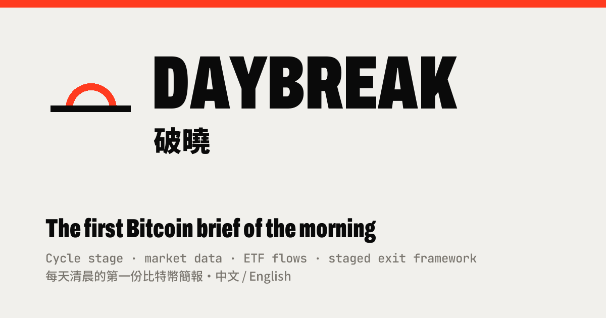

# 破曉 Daybreak

[](https://github.com/North7/daybreak/actions/workflows/daily.yml)
[](https://github.com/North7/daybreak/actions/workflows/check.yml)

**每天清晨的第一份比特幣簡報。** 今日要聞與解讀、市場數據、週期位置，以及「週期頂部分批出場」的框架與距離。

網站：<https://north7.github.io/daybreak/>（中文／英文；日刊／夜刊；可加到手機主畫面）



**[繁體中文](#繁體中文) · [English](#english)**

<a id="繁體中文"></a>


---

## 目錄

- [網站內容](#網站內容)
- [出場框架](#出場框架)
- [數字解讀](#數字解讀)
- [資料來源](#資料來源)
- [系統架構與每日流程](#系統架構與每日流程)
- [語言](#語言)
- [部署（一次性）](#部署一次性)
- [本機開發](#本機開發)
- [檔案結構](#檔案結構)
- [資料原則](#資料原則)
- [已知限制](#已知限制)
- [隱私](#隱私)
- [變更紀錄](#變更紀錄)

---

## 網站內容

9 個版面。桌面依序疊成一頁、捲動切換（鍵盤 1–9 跳版）；手機一次一版，左右滑動切換。

| # | 版面 | 看什麼 |
|---|---|---|
| 01 | **頭版** | 號外大標題、巨型收盤價（滑過可回看近 20 天）、立場與市場階段、要盯的三個價位、數據帶、資料狀態、今日要聞、今天該做什麼／今天變了什麼、今日數據與解讀、離出場線的跑道圖、價格近一年、接下來的日期 |
| 02 | **消息** | 過去 24–36 小時的重要消息（依分類篩選），每則附「對 BTC 的意義」並對照本站數據；機構研報（Glassnode、K33 等）重點 |
| 03 | **週期** | 市場階段（熊市 → 轉換期 → 牛市，規則化判定與佐證燈號）、長期路徑四種走法、MVRV ÷ 前一輪高點、頂部三指標、冪律合理價、Tidemark 頂部／底部綜合訊號 |
| 04 | **價格** | 近 20 天 K 線、ATR、實際波動、Mayer 倍數、Pi Cycle、**短週期（目前這一段行情：起點、幅度、天數、與本輪中位數比較、本段結束線）**、關鍵價位、均線排列、長期走勢 |
| 05 | **衍生品** | DVOL、IV − RV、永續資金費率（Deribit／OKX／Hyperliquid 以未平倉加權）、25Δ 風險逆轉（30 天固定期限）、選擇權未平倉與履約價分布、期貨基差曲線、**掛單簿**（13 個交易所 ±15% 全景柱狀圖、最大的牆、整數關卡）、CoinGlass 爆倉熱力圖連結 |
| 06 | **資金** | 現貨 ETF 每日淨流量（並換算成 BTC 與新挖出量比較）、BTC 與那斯達克／美元相關、10 年期實質利率、穩定幣供給、Coinbase 溢價、恐懼貪婪指數、實現市值 30 日變化（附歷次歸零之後的價格表現） |
| 07 | **鏈上** | 短期持有者獲利比例與成本、真實市場均價、交易所供給、算力與算力帶（Hash Ribbons）、難度、籌碼分布（URPD）、**鯨魚與大戶動向（依地址餘額分層，7／30／90 日與本段以來）**、鏈上指標表、頂部雷達 |
| 08 | **出場框架** | 現在離每條出場規則多遠、出場模擬器（拖動價格看框架會賣多少）、鏈上觸發、200 日均線避險、加速與時間停損 |
| 09 | **方法** | 這是什麼、原則、限制、資料來源與更新時間 |

## 出場框架

以「100% ＝ 本週期打算賣出的全部持倉」計，不涉及任何人的實際持倉。參數在 `data/model.json`，每月檢討時才改。

| 規則 | 內容 |
|---|---|
| 價格階梯 | 125K、135K、145K、155K、165K、180K、195K、215K，共 8 階，每階賣 12.5% |
| 鏈上觸發 | MVRV ÷ 前一輪高點連 5 日 ≥ 0.75 → 賣一階；連 5 日 ≥ 0.80 → 再賣一階；之後每次收盤創新高但 MVRV ≤ 一年最高的 0.9 倍 → 賣一階 |
| 加速 | 頂部三指標（MVRV Z／NUPL／Puell 四年百分位）任兩項 ≥ 80 → 頂部區；≥ 85 連 5 日 → 多賣兩階；≥ 90 → 10 個交易日內賣完 |
| 200 日均線避險 | 收盤連 5 日在 200 日均線之下 → 減 20%；連 5 日收回，或 MVRV Z 7 日均 < 0.5 → 補回 |
| 時間停損 | 2029/10–2030/03 剩餘部位每月等量賣完 |

**市場階段（P23）** 只是標籤，不連動出場規則：轉換期＝投降出現過且收盤在上升的 200 日均線之上；牛市＝收盤連 30 日在上升的 200 日均線之上（成立後單向鎖定）；退回熊市＝轉換期中連 5 日收在 200 日均線下，或牛市中連 30 日在下降的 200 日均線下。

## 數字解讀

頁面上每個數字都附一句「現在代表什麼」：由前端用當天的數值套固定門檻產生（門檻寫在句子裡），並標上 **偏多／偏空／留意／中性**。標籤只描述該數字對價格的一般含意，不是預測，也不連動出場規則。

每版最上方的「今日判讀」與頭條、新聞、行動清單，則由 Claude 每日任務讀數據後撰寫（`data/notes.json`、英文版 `data/notes.en.json`），只解釋數字、不改數字。

## 資料來源

全部是免費的公開 API，不需要任何金鑰。

| 來源 | 用在哪裡 | 更新 |
|---|---|---|
| Kraken | 日線價格、均線、ATR、波動、短週期 | 每日 |
| CoinMetrics Community | MVRV、實現價、**頂部三指標（MVRV Z／NUPL／Puell）**、交易所供給、實現市值、冪律、長期價格 | 每日（晚 1 天） |
| bitcoin-data.com | 持有者成本、LTH SOPR、籌碼流向、URPD、流動性供給、頂部雷達 | 每日 13 次請求（免費層上限 15） |
| CheckOnChain 公開圖表 | STH-SOPR（晚約 1 天；`pipeline/coc.py` 每天讀一次，失敗時用 `pipeline/coc_cache/`） | 不佔 bitcoin-data 額度 |
| Deribit | DVOL、期貨基差、選擇權、永續資金費率 | 每日 |
| OKX、Hyperliquid | 資金費率（與 Deribit 以未平倉加權） | 每日 |
| 13 個交易所掛單簿 | Coinbase、Bitstamp、Gemini、Bitfinex、Kraken、Binance、OKX、Gate、MEXC、Deribit、Kraken Futures、OKX Swap、Hyperliquid | 每日快照 |
| The Block | 現貨 ETF 每日淨流量（與 Farside 同口徑） | 每日 |
| FRED | 10 年期殖利率與實質利率、美元指數、那斯達克 | 每日 |
| mempool.space | 算力、難度、礦工收入 | 每日 |
| BitInfoCharts | 依地址餘額分層的持幣量（鯨魚與大戶）；2026-10-21 起暫停（被 Cloudflare 擋自動抓取，頁面不顯示），找到替代資料再回補 | — |
| DefiLlama | 穩定幣總供給 | 每日 |
| Coinbase、Binance | Coinbase 溢價（兩邊日線收盤價差） | 每日 |
| alternative.me | 恐懼貪婪指數 | 每日 |
| Tidemark（north7.github.io/tidemark） | 頂部／底部綜合訊號（第三方模型，只作讀值） | 每日 |

頁首「資料狀態」會列出每個來源的資料日期與落後天數；任何一個來源失敗只影響該項，頁面顯示「本日未取得」，不推估、不沿用舊數字。

## 系統架構與每日流程

```
cron-job.org ──(repository_dispatch)──▶ GitHub Actions
   22:40 UTC  prefetch.yml  → bd_rotation.py → pipeline/bd_cache/        （bitcoin-data 7 個）
   00:06 UTC  daily.yml     → collect.py → today.json
                            → etf.py     → data/etf.json
                            → build.py   → data/latest.json、data/history/、data/archive/
                            → 提交到 main ─▶ GitHub Pages
   14:00 UTC  etf.yml       → 補抓 ETF 流量

Claude 排程任務（00:30 UTC）→ brief.py 精簡摘要 + 查新聞與研報
                            → data/notes.json、data/notes.en.json → 提交到 main
瀏覽器 → index.html + assets/app.js 讀 latest.json 與 notes（英文版讀 notes.en.json）
```

| 時間（UTC） | 台北 | 誰 | 做什麼 | 耗 token |
|---|---|---|---|---|
| 22:40（前一天） | 06:40 | cron-job.org → Actions | 抓 8 個鏈上指標進 `pipeline/bd_cache/` | 0 |
| 00:06 | 08:06 | cron-job.org → Actions | 抓所有資料、算指標、更新 `data/latest.json`、封存前一期、提交 | 0 |
| 00:30 | 08:30 | Claude 排程任務 | 讀摘要、查證新聞與研報，寫頭條、各版判讀與英文版，提交 | 少量 |
| 14:00 | 22:00 | Actions | 補抓 ETF 流量（The Block 晚約一個交易日公布） | 0 |

GitHub 自己的定時排程在這個倉庫每天晚 5–7 小時，所以改由 cron-job.org 準時觸發（設定見 [docs/CRON_JOB.md](docs/CRON_JOB.md)）；原本的 `schedule` 與 Claude 推送 `.github/run-daily` 觸發都保留當備援，同一天重複觸發會自動略過。`notes.json` 的日期若和資料日不同，網站仍顯示上一期的判讀並標示，數字永遠是最新的。

## 語言

- 網站有中文（繁體）與英文兩種版本，右上角（手機）或側欄底部（桌面）切換。
- 使用者選過語言就一直沿用（存在瀏覽器 localStorage）。
- 沒選過時依訪客 IP 所在國家決定預設：**台灣、香港、澳門、中國大陸、新加坡用中文，其他地區用英文**。國家由瀏覽器向 api.country.is（備援 get.geojs.io）查詢，快取 7 天；查不到時看瀏覽器語言。
- 介面文字都經過 `_t()`，英文在 `assets/i18n-en.js`；數字解讀兩種語言都由前端產生；每日判讀需要 Claude 任務另寫 `data/notes.en.json`，缺檔時英文版退回中文並標示。

## 部署（一次性）

1. 建立公開倉庫並把內容推到 `main`。
2. **Settings → Pages**：Source 選「Deploy from a branch」，Branch `main`、資料夾 `/ (root)`。
3. **Settings → Actions → General → Workflow permissions** 選「Read and write permissions」。
4. Actions 頁面手動執行一次「Daily data」，確認 `data/latest.json` 有更新。
5. 依 [docs/CRON_JOB.md](docs/CRON_JOB.md) 建 GitHub token，在 cron-job.org 建兩個工作（daily-data 00:06、prefetch 22:40，UTC）。
6. 在 Claude Code 建每日排程任務（UTC 00:30），指示內容見 [docs/CLAUDE_DAILY.md](docs/CLAUDE_DAILY.md)。

## 本機開發

```bash
# 預覽網站（讀 repo 裡現有的 data/）
python3 -m http.server 8765        # 打開 http://localhost:8765/

# 改過 assets/ 之後：更新版本號，避免手機拿到新舊混搭的 CSS／JS
python3 pipeline/stamp_assets.py

# 改過 app.js 的文字之後：檢查每個 _t() 都有英文（缺的補進 assets/i18n-en.js）
python3 pipeline/check_i18n.py

# 渲染測試：中文／英文 × 桌面／手機，每一版都要能渲染、沒有 JS 錯誤、不能橫向捲動
npm i --no-save playwright@1.56.1 && npx playwright install chromium
node tests/smoke.js                # 需要上面的 http.server 在跑

# 完整跑一次資料管線（會打真實 API；bitcoin-data 每個 IP 每天 15 次，自己電腦跑也會用掉）
cd pipeline && python3 collect.py --up 87447 --down 82288 --prev-state state_min.json && cd ..
python3 pipeline/build.py pipeline/today.json
```

PR 會自動跑 **Site checks**（`.github/workflows/check.yml`）：語法、英文字典、版本號、用無頭瀏覽器渲染每一版。開發慣例：

- 網站純靜態、無外部套件、無建置步驟；圖表是手寫 SVG。
- 新文字用 `_t('中文')` 並把英文加進 `assets/i18n-en.js`；中英語序差很多的句子用 `_T('中文', 'English')`。
- 資料欄位一律「取不到就 null 並寫進 errors」，不推估。

## 檔案結構

```
index.html               網站入口（含開機腳本：先決定語言再啟動 app.js）
manifest.webmanifest     加到手機主畫面（圖示 assets/icon-*.png；中文預覽圖 assets/og.png）
assets/app.css           品牌與版面（號外風格；日刊／夜刊兩種主題）
assets/app.js            路由、圖表、數字解讀、互動（無外部套件）
assets/i18n-en.js        英文字典（中文原句 → 英文）
assets/logo.svg、favicon.svg
data/latest.json         每日資料（由 Actions 產生，不要手改）
data/notes.json          每日頭條、各版判讀、行動、變化、要聞與研報（Claude 每日任務寫入）
data/notes.en.json       notes.json 的英文版
data/etf.json            ETF 每日淨流量
data/model.json          固定模型參數：出場框架、長期路徑（每月檢討時才改；含 *_en 英文規則文字）
data/history/index.json  每日快照索引
data/archive/            往期封存：每期 notes（含英文版）與 index.json（頭條、當天收盤、之後漲跌、要盯的價位有沒有被碰到）。
                         目前只封存，網站上沒有往期頁面（2026-10-12 決定，之後再設計）
pipeline/collect.py      抓取所有 API 並計算指標 → pipeline/today.json
pipeline/build.py        today.json → data/latest.json；最後呼叫 archive.py 封存前一期
pipeline/archive.py      往期封存（一次性回填：python3 pipeline/archive.py --backfill-git）
pipeline/brief.py        印出精簡摘要給 Claude 讀
pipeline/etf.py          從 The Block 更新 ETF 每日淨流量
pipeline/bd_rotation.py  bitcoin-data 請求分配：每日即時 6 個 + 前一晚 7 個
pipeline/coc.py          STH-SOPR：讀 CheckOnChain 公開圖表（晚約 1 天）
pipeline/bd_cache/       前一晚抓的鏈上指標快取
pipeline/check_i18n.py   檢查 app.js 每個 _t() 都有英文
pipeline/stamp_assets.py 更新 index.html 的 ?v= 版本號
pipeline/share_card.py   每日分享圖 data/share.png、data/share-en.png（X 貼文附圖）
post.html                X 發文小幫手（讀 data/x_post.json：手機用分享選單把圖文一起送進 X、存圖到相簿、開 X App 發文視窗、複製文字）
pipeline/og_card.py      連結預覽卡 assets/og-en.png（網址貼到 X 時自動顯示，預設英文；中文版 assets/og.png）
pipeline/x_len.py        檢查 data/x_post.json 中英貼文在 X 的 280 字內
pipeline/params.json     collect.py 需要的兩個參數（T+5 上下門檻）
pipeline/state_min.json  前一日的最小狀態（URPD 週變化、ATR 回測、市場階段）
tests/smoke.js           渲染測試
.github/workflows/daily.yml     每日資料（cron-job.org 00:06 UTC 觸發；schedule 與推送觸發為備援）
.github/workflows/prefetch.yml  鏈上快取（cron-job.org 22:40 UTC 觸發）
.github/workflows/etf.yml       每天 14:00 UTC 補抓 ETF
.github/workflows/check.yml     PR 檢查
.github/workflows/share.yml     日報推送後自動產生分享圖
docs/CLAUDE_DAILY.md     Claude 每日任務的完整指示
docs/CRON_JOB.md         cron-job.org 準時觸發的設定步驟
```

## 資料原則

- **先給結論，再給證據。** 每版先寫「所以呢」，數字放在後面。
- **寧可「本日未取得」，也不推估或沿用舊數字。**
- **不同資料商的數字不相減**（例如 CoinMetrics 的 MVRV 與 bitcoin-data 的 MVRV Z 口徑不同）。
- **分數附樣本數**，樣本少於 30 不下結論；週期模型只有 3–4 輪歷史，所有「遞減」推論都假設趨勢延續。
- **只作讀值的東西不連動規則**：數字解讀、短週期、鯨魚、市場階段、Tidemark、新聞都不改變出場框架。

## 已知限制

- **bitcoin-data.com** 免費層每小時 10 次、每日 15 次；目前每天用 13 次（STH-SOPR 改由 CheckOnChain 提供）。部分序列（例如持有者成本）本身就晚 5–6 天，頁首「資料狀態」會標出落後天數。
- **ETF**：Farside 用 Cloudflare 擋自動抓取，改用 The Block 的圖表 JSON（逐日與 Farside 比對一致）；The Block 只公布已完整的交易日，約晚一天。
- **掛單簿**是資料管線執行當下的快照；Binance 期貨與 Bybit 讀不到，永續部分偏低估；掛單隨時可撤。
- **鯨魚分層**：地址不等於實體，≥10K BTC 的地址多為交易所冷錢包與 ETF 託管，錢包整理會讓幣在分層之間移動；若 BitInfoCharts 改版或擋 GitHub Actions，該區塊顯示「本日未取得」。
- **Coinbase 溢價**以 Binance 的 USDT 報價比較，USDT 偏離 1 美元時會有誤差。
- **字型**：內文中文用系統字型，只有標題載入 Noto Sans TC 900；Google Fonts 在中國大陸讀不到時改用備用字型，版面已確認不會橫向溢出。
- **IP 判斷語言**會把訪客 IP 送到 api.country.is／get.geojs.io 查國家（只查國家代碼，結果存在訪客自己的瀏覽器）。

## X 推廣

- 每天 08:30 的日報任務寫完後，另寫 `data/x_post.json`（中英各一則 X 貼文草稿）並推播到手機，複製貼上即可發。
- 日報推送後，`share.yml` 自動產生號外風格的分享圖：`data/share.png`（中文）、`data/share-en.png`（英文）。
- 網站側欄與頁尾有追蹤 [@songpu717](https://x.com/songpu717) 的連結；貼文連結帶 `?utm_source=x`。
- 訪客統計用 GoatCounter（不用 cookie、不收個資），站點代號 `daybreak`，只在正式網址計數。
- 發文小幫手 [`post.html`](https://north7.github.io/daybreak/post.html)：一鍵複製中英文貼文、開好 X 發文視窗、存分享圖。
- 網址貼到 X 時自動顯示的連結預覽卡預設英文（`assets/og-en.png`，由 `pipeline/og_card.py` 產生）；中文版是 `assets/og.png`。

## 隱私

這是公開倉庫，所有歷史提交永久可查。網站只放市場資料與通用的出場框架（以「100% ＝ 本週期打算賣出的全部持倉」計），**不得出現任何人的實際持倉數量、買賣數量或資金金額**；Claude 每日任務在提交前會掃描 notes 確認。

## 變更紀錄

- **2026-09-22** 建立資料管線與網站。
- **2026-10-02** 籌碼流向圖表、掛單簿深度（3 家）、常駐圖表區。
- **2026-10-06** Tidemark 綜合訊號、冪律讀值、掛單簿全景擴大到 13 個交易所。
- **2026-10-08** bitcoin-data 請求分批輪替；ETF 改用 The Block。
- **2026-10-09** 市場階段（P23）規則修訂，佐證燈號。
- **2026-10-12**
  - 每個數字附解讀；英文版與依 IP 判斷語言；手機日夜／語言切換。
  - 新增：實現市值 30 日變化、鯨魚與大戶、短週期、穩定幣、Coinbase 溢價、算力帶、ETF 換算 BTC、多家資金費率、恐懼貪婪。
  - 頂部三指標改用 CoinMetrics（只晚 1 天）；25Δ 風險逆轉改 30 天固定期限；頁首資料狀態。
- **2026-10-15**
  - STH-SOPR 改用 CheckOnChain 公開圖表（晚約 1 天，原本 bitcoin-data 晚約 7 天），bitcoin-data 每日請求降為 13 次。
- **2026-10-14**
  - 市場階段佐證燈號加第 6 盞：短期持有者成本 vs 真實市場均價（只作佐證）；六盞燈都有近 3 年走勢圖配 BTC 價格線，附「離翻轉多遠、以近 30 日速度大約何時交叉」的讀值（`pipeline/stage_viz.py`）。
  - X 推廣：英文連結預覽卡、發文小幫手 `post.html`。
  - 鏈上版：短期持有者認賠賣壓（STH-SOPR，自動標出「賣壓遞減／加重」）；鏈上指標表與頂部雷達的 11 項都有近 3 年走勢圖配價格線。
  - 全站每張圖下方加「讀圖」：「現在」一句依當日資料自動產生，「怎麼讀這張圖」說明圖上是什麼、怎麼看、要小心什麼。虛線一律代表推測或還沒發生的部分。
  - 掛單簿併入衍生品版；字型瘦身；往期自動封存；PR 自動檢查；cron-job.org 準時觸發；PWA 與分享預覽圖。

---

僅供研究與教育參考，不構成投資建議。加密資產波動極大，請依自身情況判斷並自負風險。

---

<a id="english"></a>

## English

**The first Bitcoin brief of the morning.** The day's news with analysis, market and on-chain data, where we are in the cycle, and how far price is from each rule of a staged exit plan for a cycle top.

Site: <https://north7.github.io/daybreak/> (Chinese / English; light / dark; installable on the phone home screen)

### What's on the site

Nine sections. On desktop they stack into one page and switch as you scroll (keys 1–9 jump between them); on phones one section shows at a time and you swipe left/right.

| # | Section | What you see |
|---|---|---|
| 01 | **Front page** | Headline, the giant closing price (hover to step back through 20 days), stance and market stage, three levels to watch, data tape, data-status bar, today's news, what to do / what changed, today's numbers with readings, the runway to each exit line, the 12-month price chart, upcoming dates |
| 02 | **News** | Key stories from the last 24–36 hours (filter by category), each with what it means for BTC checked against our data; institutional research (Glassnode, K33, …) |
| 03 | **Cycle** | Market stage (bear → transition → bull, rule-based with supporting signals), four long-term paths, MVRV ÷ prior-cycle peak, the top-3 indicators, power-law fair value, Tidemark top/bottom signals |
| 04 | **Price** | 20 daily candles, ATR, realized volatility, Mayer multiple, Pi Cycle, **short cycle (the current price leg: start, size, length vs. this cycle's median, the close that would end it)**, key levels, moving-average alignment, long-term chart |
| 05 | **Derivatives** | DVOL, IV − RV, perp funding (Deribit / OKX / Hyperliquid, open-interest weighted), 25Δ risk reversal (30-day constant maturity), options open interest and strikes, futures basis curve, **order book** (13 exchanges, ±15% full-view bar chart, biggest walls, round numbers), link to the CoinGlass liquidation heatmap |
| 06 | **Flows** | Spot ETF daily net flows (also in BTC vs. newly mined supply), BTC correlation with Nasdaq / USD, 10-yr real yield, stablecoin supply, Coinbase premium, Fear & Greed, realized-cap 30-day change (with what price did after every past zero) |
| 07 | **On-chain** | Short-term holders in profit and their cost basis, True Market Mean, exchange supply, hashrate and Hash Ribbons, difficulty, supply distribution (URPD), **whale and big-holder activity (by address-balance tier: 7 / 30 / 90 days and this leg)**, on-chain metrics table, top radar |
| 08 | **Exit plan** | How far price is from each exit rule, an exit simulator (drag a price and see what the plan would have sold), on-chain triggers, 200-day MA hedge, acceleration and time stop |
| 09 | **Method** | What this is, principles, limits, data sources and update times |

### The exit plan

Measured as "100% = everything you plan to sell this cycle"; nobody's actual holdings are involved. Parameters live in `data/model.json` and only change at the monthly review.

| Rule | What it does |
|---|---|
| Price ladder | 125K, 135K, 145K, 155K, 165K, 180K, 195K, 215K — 8 steps, 12.5% each |
| On-chain triggers | MVRV ÷ prior-cycle peak ≥ 0.75 for 5 days → sell one step; ≥ 0.80 for 5 days → one more; after both, each new closing high with MVRV ≤ 0.9× its 1-year high → one more |
| Acceleration | Top-3 indicators (MVRV Z / NUPL / Puell, 4-year percentiles): any two ≥ 80 → top zone; ≥ 85 for 5 days → sell two extra steps; ≥ 90 → sell everything within 10 trading days |
| 200-day MA hedge | Close below the 200-day MA for 5 days → cut 20%; buy back after 5 closes above it, or when the MVRV Z 7-day average < 0.5 |
| Time stop | 2029/10–2030/03: sell what is left in equal monthly amounts |

**Market stage (P23)** is a label only and does not drive the exit rules: transition = capitulation has occurred and the close is above a rising 200-day MA; bull = 30 straight closes above a rising 200-day MA (then locked one way); back to bear = 5 closes below the 200-day MA during a transition, or 30 closes below a falling 200-day MA in a bull market.

### Readings under every number

Every number on the page carries a one-line "what this means now", generated in the browser from the day's value and fixed thresholds (the thresholds are written in the sentence) and tagged **Bullish / Bearish / Caution / Neutral**. Tags describe what the number usually means for price; they are not forecasts and do not drive the exit rules.

The "Today's read" at the top of each section, the headline, the news and the action list are written by a scheduled Claude task after it reads the data (`data/notes.json`, English in `data/notes.en.json`). The commentary explains numbers; it never changes them.

### Data sources

All free public APIs; no keys required.

| Source | Used for | Update |
|---|---|---|
| Kraken | Daily price, moving averages, ATR, volatility, short cycle | Daily |
| CoinMetrics Community | MVRV, realized price, **top-3 indicators (MVRV Z / NUPL / Puell)**, exchange supply, realized cap, power law, long-term price | Daily (1-day lag) |
| bitcoin-data.com | Holder cost basis, LTH SOPR, supply flows, URPD, liquid supply, top radar | 13 requests a day (free tier allows 15) |
| CheckOnChain public charts | STH-SOPR (about 1 day late; `pipeline/coc.py` reads it once a day and falls back to `pipeline/coc_cache/`) | Doesn't use bitcoin-data quota |
| Deribit | DVOL, futures basis, options, perp funding | Daily |
| OKX, Hyperliquid | Funding (OI-weighted with Deribit) | Daily |
| 13 exchange order books | Coinbase, Bitstamp, Gemini, Bitfinex, Kraken, Binance, OKX, Gate, MEXC, Deribit, Kraken Futures, OKX Swap, Hyperliquid | Daily snapshot |
| The Block | Spot ETF daily net flows (same basis as Farside) | Daily |
| FRED | 10-yr nominal and real yields, dollar index, Nasdaq | Daily |
| mempool.space | Hashrate, difficulty, miner revenue | Daily |
| BitInfoCharts | Holdings by address-balance tier (whales and big holders); paused since 2026-10-21 (Cloudflare blocks automated requests; hidden on the site) until a replacement source is found | — |
| DefiLlama | Total stablecoin supply | Daily |
| Coinbase, Binance | Coinbase premium (difference between their daily closes) | Daily |
| alternative.me | Fear & Greed Index | Daily |
| Tidemark (north7.github.io/tidemark) | Top/bottom composite signals (third-party model, reading only) | Daily |

The "Data status" bar at the top lists every source's data date and lag. If a source fails, only that item shows "not available today" — nothing is estimated or carried over.

### Architecture and daily schedule

```
cron-job.org ──(repository_dispatch)──▶ GitHub Actions
   22:40 UTC  prefetch.yml  → bd_rotation.py → pipeline/bd_cache/        (7 bitcoin-data series)
   00:06 UTC  daily.yml     → collect.py → today.json
                            → etf.py     → data/etf.json
                            → build.py   → data/latest.json, data/history/, data/archive/
                            → commit to main ─▶ GitHub Pages
   14:00 UTC  etf.yml       → ETF flow catch-up

Scheduled Claude task (00:30 UTC) → brief.py summary + news and research checks
                                  → data/notes.json, data/notes.en.json → commit to main
Browser → index.html + assets/app.js read latest.json and notes (English reads notes.en.json)
```

| UTC | Taipei | Who | What | Tokens |
|---|---|---|---|---|
| 22:40 (day before) | 06:40 | cron-job.org → Actions | Fetch 8 on-chain series into `pipeline/bd_cache/` | 0 |
| 00:06 | 08:06 | cron-job.org → Actions | Fetch everything, compute, update `data/latest.json`, archive the previous edition, commit | 0 |
| 00:30 | 08:30 | Claude task | Read the summary, verify news and research, write the headline, section reads and the English edition, commit | Few |
| 14:00 | 22:00 | Actions | ETF flow catch-up (The Block publishes about one trading day late) | 0 |

GitHub's own cron runs 5–7 hours late on this repository, so cron-job.org triggers the workflows on time (setup in [docs/CRON_JOB.md](docs/CRON_JOB.md)). The original `schedule` and the Claude task's push to `.github/run-daily` remain as fallbacks; duplicate triggers on the same day exit early. If `notes.json` is older than the data, the site shows the previous edition's commentary with a label, while every number is current.

### Languages

- Traditional Chinese and English; switch at the top right (phone) or the bottom of the sidebar (desktop).
- A visitor's choice is remembered (browser localStorage).
- Without a choice, the visitor's country decides: **Taiwan, Hong Kong, Macau, mainland China and Singapore get Chinese; everyone else gets English.** The browser asks api.country.is (fallback get.geojs.io) for the country code and caches it for 7 days; if that fails, the browser language decides.
- UI text goes through `_t()` with English in `assets/i18n-en.js`; readings are generated in both languages; the daily commentary needs the Claude task to write `data/notes.en.json` (if it is missing, English pages fall back to Chinese with a notice).

### Deploy (one time)

1. Create a public repository and push to `main`.
2. **Settings → Pages**: "Deploy from a branch", branch `main`, folder `/ (root)`.
3. **Settings → Actions → General → Workflow permissions**: "Read and write permissions".
4. Run "Daily data" once from the Actions tab and check that `data/latest.json` updates.
5. Follow [docs/CRON_JOB.md](docs/CRON_JOB.md) (in Chinese): create a GitHub token and two cron-job.org jobs (daily-data 00:06, prefetch 22:40, UTC).
6. Create the scheduled Claude Code task (00:30 UTC) with the instructions in [docs/CLAUDE_DAILY.md](docs/CLAUDE_DAILY.md).

### Local development

```bash
# Preview the site (uses the data/ already in the repo)
python3 -m http.server 8765        # open http://localhost:8765/

# After changing assets/: bump version stamps so phones never mix old and new CSS/JS
python3 pipeline/stamp_assets.py

# After changing text in app.js: every _t() string needs English (add missing ones to assets/i18n-en.js)
python3 pipeline/check_i18n.py

# Render test: zh/en × desktop/phone; every section must render with no JS errors and no horizontal scroll
npm i --no-save playwright@1.56.1 && npx playwright install chromium
node tests/smoke.js                # needs the http.server above

# Run the whole pipeline (real APIs; bitcoin-data allows 15 requests per IP per day, including yours)
cd pipeline && python3 collect.py --up 87447 --down 82288 --prev-state state_min.json && cd ..
python3 pipeline/build.py pipeline/today.json
```

Pull requests run **Site checks** (`.github/workflows/check.yml`): syntax, English dictionary coverage, version stamps, and a headless render of every section. Conventions:

- Static site, no external libraries, no build step; charts are hand-written SVG.
- New text uses `_t('中文')` with its English added to `assets/i18n-en.js`; sentences whose word order differs a lot use `_T('中文', 'English')`.
- A data field that cannot be fetched is null and listed in `errors` — never estimated.

### Data principles

- **Conclusion first, evidence second.**
- **"Not available today" beats an estimate or yesterday's number.**
- **Numbers from different vendors are never subtracted** (e.g. CoinMetrics MVRV vs. bitcoin-data MVRV Z).
- **Scores come with sample sizes**; nothing is concluded from fewer than 30 samples. The cycle model has only 3–4 cycles of history, and every "diminishing returns" inference assumes the trend continues.
- **Readings never drive rules**: number readings, the short cycle, whales, market stage, Tidemark and news do not change the exit plan.

### Known limits

- **bitcoin-data.com** free tier: 10 requests per hour, 15 per day; we use 13 (STH-SOPR now comes from CheckOnChain). Some series (e.g. holder cost basis) are themselves 5–6 days behind; the data-status bar shows the lag.
- **ETF flows**: Farside blocks automated access behind Cloudflare, so we use The Block's chart JSON (matches Farside day by day); The Block only publishes complete trading days, about one day late.
- **Order book** is a snapshot at pipeline run time; Binance futures and Bybit are not readable, so perpetual depth is understated; orders can be pulled at any time.
- **Whale tiers**: one address is not one entity; ≥10K BTC addresses are mostly exchange cold wallets and ETF custodians, and wallet reshuffles move coins between tiers. If BitInfoCharts changes its page or blocks GitHub Actions, the panel shows "not available today".
- **Coinbase premium** is measured against Binance's USDT price; USDT deviating from $1 adds noise.
- **Fonts**: body Chinese uses system fonts; only headings load Noto Sans TC 900. Where Google Fonts is unreachable (e.g. mainland China), fallback fonts are used and the layout has been checked for horizontal overflow.
- **IP-based language** sends the visitor's IP to api.country.is / get.geojs.io to get a country code (stored only in the visitor's own browser).

### Promotion on X

- After the 08:30 daily task finishes the notes, it writes `data/x_post.json` (one X post draft in Chinese, one in English) and sends it to the phone as a push notification, ready to copy and post.
- Once the notes are pushed, `share.yml` draws Extra-style share cards: `data/share.png` (Chinese) and `data/share-en.png` (English).
- The sidebar and footer link to [@songpu717](https://x.com/songpu717); post links carry `?utm_source=x`.
- Visitor stats use GoatCounter (no cookies, no personal data), site code `daybreak`, counted on the live URL only.
- [`post.html`](https://north7.github.io/daybreak/post.html) is the posting helper: copy either draft with one tap, open X's composer pre-filled, save the share card.
- The link preview X shows for the site URL defaults to English (`assets/og-en.png`, drawn by `pipeline/og_card.py`); the Chinese card is `assets/og.png`.

### Privacy

This repository is public and its history is permanent. The site holds only market data and a generic exit framework ("100% = everything you plan to sell this cycle"); **it must never contain anyone's actual holdings, trade sizes or amounts of money.** The Claude task scans the notes for this before committing.

### Changelog

- **2026-09-22** Data pipeline and site created.
- **2026-10-02** Supply-flow charts, order-book depth (3 venues), always-on charts.
- **2026-10-06** Tidemark composite signals, power-law readings, order-book full view expanded to 13 exchanges.
- **2026-10-08** bitcoin-data requests split and rotated; ETF flows moved to The Block.
- **2026-10-09** Market stage (P23) rules revised; supporting signals.
- **2026-10-12**
  - A reading under every number; English edition with IP-based default language; theme/language switch on phones.
  - New: realized-cap 30-day change, whales and big holders, short cycle, stablecoins, Coinbase premium, Hash Ribbons, ETF flows in BTC, multi-venue funding, Fear & Greed.
  - Top-3 indicators from CoinMetrics (1-day lag); 25Δ risk reversal at 30-day constant maturity; data-status bar.
- **2026-10-15**
  - STH-SOPR now comes from CheckOnChain's public chart (about 1 day late, vs ~7 days at bitcoin-data); bitcoin-data use drops to 13 requests a day.
- **2026-10-14**
  - Sixth supporting light for the market stage: short-term holder cost vs true market mean (supporting only). All six lights get 3-year charts with the BTC price, plus a reading of how far each is from flipping and, at the last 30 days' pace, roughly when the lines cross (`pipeline/stage_viz.py`).
  - Promotion on X: English link-preview card, posting helper `post.html`.
  - On-chain page: short-term holder loss selling (STH-SOPR, flagging easing or heavier selling on retests); 3-year charts with the price for all 11 indicators in the on-chain table and top radar.
  - Every chart gets a reading block: a "Now" line generated from the day's data, and "How to read this chart" (what it shows, how to read it, caveats). Dashed lines always mean projections or things that haven't happened yet.
  - Order book moved into Derivatives; slimmer fonts; daily edition archive; PR checks; on-time triggers via cron-job.org; PWA and share image.

---

For research and education only; not investment advice. Crypto assets are extremely volatile — make your own decisions and take your own risks.
